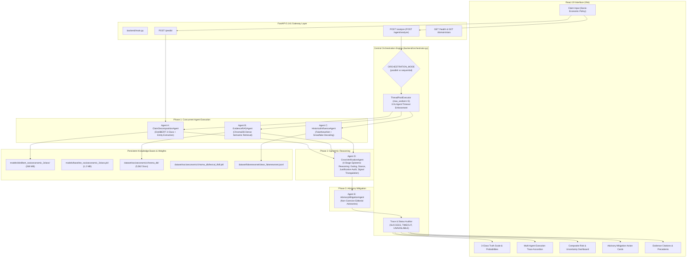

# AI-Powered Agentic System for Political Misinformation Detection, Influence Analysis and Propagation Mitigation

[](https://fastapi.tiangolo.com)
[](https://react.dev)
[](https://pytorch.org)
[](https://www.trychroma.com)
[]()
[]()
[-brightgreen?style=flat&logo=pytest)](https://docs.pytest.org)
[](LICENSE)

An academic and production-ready decision-support system designed to detect political misinformation, retrieve historical fact-checking evidence via persistent Semantic RAG, evaluate historical social influence patterns via Twitter Snowflake decoding, and formulate responsible, non-coercive mitigation advisories through a coordinated 5-agent architecture.

---

## Table of Contents
1. [Project Overview](#1-project-overview)
2. [Domain Definition & Scope](#2-domain-definition--scope)
3. [Canonical 3-Class Truthfulness Formulation](#3-canonical-3-class-truthfulness-formulation)
4. [System Architecture](#4-system-architecture)
5. [Multi-Agent Architecture & Epistemic Reasoning](#5-multi-agent-architecture--epistemic-reasoning)
6. [Machine Learning Models & Empirical Evaluation](#6-machine-learning-models--empirical-evaluation)
7. [ChromaDB Vector Store & Semantic RAG Engine](#7-chromadb-vector-store--semantic-rag-engine)
8. [Data Leakage Prevention Audit](#8-data-leakage-prevention-audit)
9. [Empirical Orchestration Benchmark](#9-empirical-orchestration-benchmark)
10. [Historical Influence & Snowflake Propagation](#10-historical-influence--snowflake-propagation)
11. [Project Repository Structure](#11-project-repository-structure)
12. [Installation & Execution Guide](#12-installation--execution-guide)
13. [API Endpoint Documentation](#13-api-endpoint-documentation)
14. [Testing & Verification](#14-testing--verification)
15. [Team Workstream Allocation](#15-team-workstream-allocation)
16. [Academic Project Disclaimer](#16-academic-project-disclaimer)

---

## 1. Project Overview

Political misinformation frequently blends partial truths, statistical distortions, and out-of-context fiscal claims. Generic sequence classifiers provide ungrounded labels without primary justification, while public LLMs suffer from hallucination and lack evidentiary citations.

This system provides a grounded multi-agent fact-checking and mitigation platform tailored strictly to **Socio-Economic & Domestic Public Welfare Policy**:
- **Transformer Sequence Classification:** Fine-tuned 3-class DistilBERT classifier trained on 5,562 canonical policy statements.
- **Persistent Semantic RAG:** ChromaDB dense semantic vector search (`all-MiniLM-L6-v2`) over 5,562 training records with 99.23% verified fact-checker justifications.
- **Deterministic Social Influence Analysis:** Twitter Snowflake bit-shift timestamp decoding from FakeNewsNet without external API dependencies.
- **4-Stage Epistemic Verification:** Agent D critically examines evidence relevance, directional stance, and journalist justifications—strictly rejecting blind assumption of historical verdicts as ground truth.
- **Non-Coercive Mitigation Advisories:** Formulates transparent, prioritized decision-support guidance (banners, reviews, omitted context notes) with zero automated content suppression.

---

## 2. Domain Definition & Scope

To satisfy academic defensibility and avoid vague generalizations across politics, the project isolates **Socio-Economic & Domestic Public Welfare Policy**.

### Canonical Dataset Statistics (`dataset/socioeconomic/`)
- **Total Corpus Size:** **6,944 records**
- **Train Split:** **5,562 records** (80.1%)
- **Validation Split:** **699 records** (10.1%)
- **Test Split:** **683 records** (9.8%)
- **Fact-Checker Justification Coverage:** **6,896 of 6,944 records (99.31%)**
  - Train: 5,519 of 5,562 (99.23%)
  - Validation: 698 of 699 (99.86%)
  - Test: 679 of 683 (99.41%)

The dataset comprises verified statements on healthcare (ACA, Medicare, Medicaid), taxes, economy, jobs, federal budget, Social Security, education, infrastructure, and welfare programs.

---

## 3. Canonical 3-Class Truthfulness Formulation

The project replaces the noisy 6-class LIAR taxonomy with a 3-class tertiary formulation:

| Class ID | Label | Mapping from LIAR | Dataset Count | Dataset % | Description |
| :---: | :--- | :--- | :---: | :---: | :--- |
| **0** | **Misleading** | `false`, `pants-fire` | 1,838 | 26.47% | Substantively false, fabricated, or severely distorted assertions. |
| **1** | **Half-True** | `half-true`, `barely-true` | 2,684 | 38.65% | Partially accurate but omitting critical fiscal context, baselines, or dates. |
| **2** | **Factual** | `true`, `mostly-true` | 2,422 | 34.88% | Substantially accurate statements corroborated by official empirical records. |

### Distribution by Split

| Split | Misleading (0) | Half-True (1) | Factual (2) | Total Records |
| :--- | :---: | :---: | :---: | :---: |
| **Train** | 1,471 (26.45%) | 2,140 (38.48%) | 1,951 (35.08%) | **5,562** |
| **Validation** | 196 (28.04%) | 278 (39.77%) | 225 (32.19%) | **699** |
| **Test** | 171 (25.04%) | 266 (38.95%) | 246 (36.02%) | **683** |
| **Overall** | **1,838 (26.47%)** | **2,684 (38.65%)** | **2,422 (34.88%)** | **6,944** |

---

## 4. System Architecture



---

## 5. Multi-Agent Architecture & Epistemic Reasoning

The system deploys 5 specialized agents coordinated by `OrchestrationWorkflow`:

| Agent | Class Identifier | Primary Responsibility | Key Output Fields |
| :--- | :--- | :--- | :--- |
| **Agent A** | `ClaimAnalysisAgent` (`ClaimDecompositionAgent`) | Computes calibrated 3-class DistilBERT probabilities and extracts monetary amounts, percentages, and policy agency entities. | `label`, `confidence`, `probabilities`, `decomposed_elements`, `risk_tier` |
| **Agent B** | `EvidenceRAGAgent` | Executes semantic search over ChromaDB embeddings, retrieving historical PolitiFact rulings and auditing justification availability. | `citations`, `verdict_distribution`, `missing_justification_count`, `has_conflicts` |
| **Agent C** | `HistoricalInfluenceAgent` | Matches claims against FakeNewsNet stories, decodes 64-bit Twitter Snowflake timestamps, and computes velocity percentiles. | `matched_stories`, `engagement_velocity`, `velocity_percentile` |
| **Agent D** | `VerificationRiskAgent` (`CrossVerificationAgent`) | Executes 4-stage epistemic synthesis, calculates composite risk (0–100), and bounds uncertainty. | `composite_risk_score`, `risk_level`, `epistemic_stance`, `evidence_conflict`, `uncertainty_score` |
| **Agent E** | `MitigationRecommendationAgent` (`AdvisoryMitigationAgent`) | Produces non-coercive editorial actions (banners, baseline notes, editorial reviews). | `public_flag`, `recommended_action`, `recommendations`, `executed_interventions_count: 0` |

### Agent D's 4-Stage Epistemic Reasoning
Agent D explicitly avoids treating historical RAG verdicts as ground truth:
1. **Relevance Gating:** Evaluates cosine similarity ($S \ge 0.70$ direct precedent, $S \ge 0.40$ context) and policy entity overlap.
2. **Directional Stance:** Analyzes assertion polarity to determine whether historical evidence supports, contradicts, or presents a neutral stance toward the user's claim.
3. **Justification Analysis:** Audits cited fact-checker justifications, numbers, and flags missing justifications.
4. **Cross-Signal Triangulation:** Weighs classifier risk (50%), evidence risk (35%), and engagement velocity (15%) to generate a composite risk score (0–100) and quantify uncertainty.

---

## 6. Machine Learning Models & Empirical Evaluation

### Empirical Performance Comparison on 683 Test Claims

| Metric | TF-IDF Baseline Fallback | Fine-Tuned DistilBERT (3-Class) | Absolute Improvement |
| :--- | :---: | :---: | :---: |
| **Test Accuracy** | 43.48% | **45.97%** | **+2.49%** |
| **Macro F1 Score** | 0.4288 | **0.4548** | **+0.0260** |
| **Weighted F1 Score** | 0.4358 | **0.4601** | **+0.0243** |
| **Misleading F1** | 0.3698 | **0.4022** | **+0.0324** |
| **Half-True F1** | 0.4259 | **0.4388** | **+0.0129** |
| **Factual F1** | 0.4907 | **0.5233** | **+0.0326** |

- **Artifacts Location:** `models/distilbert_socioeconomic_3class/` (`config.json`, `model.safetensors`, `tokenizer.json`, `vocab.txt`).
- **Baseline Fallback:** `models/baseline_socioeconomic_3class.pkl` (TF-IDF + Logistic Regression) is maintained as an offline benchmark and runtime fallback.
- **Metrics JSON:** Empirical results logged in `models/distilbert_socioeconomic_3class_metrics.json`.

---

## 7. ChromaDB Vector Store & Semantic RAG Engine

- **Vector Store Directory:** `dataset/socioeconomic/chroma_db/`
- **Collection Name:** `'socioeconomic_evidence'`
- **Total Indexed Documents:** **Exactly 5,562 records** (100% of the training split)
- **Justification Coverage:**
  - 5,519 records with verified journalist justifications (`has_justification: true`)
  - 43 records with explicit placeholder text (`has_justification: false`)
- **Embedding Model:** Built-in ONNX `all-MiniLM-L6-v2` (`DefaultEmbeddingFunction()`, 384 dimensions).
- **Retrieval Mechanism:** **Semantic-Only Vector Similarity**. Queries ChromaDB collection directly using cosine similarity derived from inner-product distance:
  $$\text{Similarity}_{\text{semantic}} = \max(0.0, \min(1.0, 1.0 - \text{distance}))$$
- **Decoupled Architecture:** Lexical retrieval and Reciprocal Rank Fusion (RRF) / score weighting have been removed from the active evidence retrieval pipeline.
- **Classification Baseline Preservation:** The 3-class TF-IDF classification baseline (`models/baseline_socioeconomic_3class.pkl`) remains completely intact and operational as an independent classification fallback.

---

## 8. Data Leakage Prevention Audit

A 4-tier leakage audit (`tests/test_rag_leakage.py`) guarantees data split isolation:
- **Tier 1 (ID Disjointness):** 0 overlapping statement IDs between Train (5,562), Val (699), and Test (683).
- **Tier 2 (Exact Text Collisions):** Audited the Julian Castro collision (`6622.json` [Train] vs `6370.json` [Test]) as an identical public talking point delivered on different dates, retaining both with split provenance.
- **Tier 3 (Near-Duplicate Screening):** Confirmed Jaccard 3-gram similarities $>0.85$ are natural campaign repetitions rather than synthetic dataset duplication.
- **Tier 4 (ChromaDB Provenance):** Verified all 5,562 records in `'socioeconomic_evidence'` originate exclusively from `split: "train"`.
- **Audit Report:** Generated and committed at `dataset/socioeconomic/leakage_audit_report.json`.

---

## 9. Empirical Orchestration Benchmark

Benchmarked on target hardware (12-core CPU) over 100 sample policy claims from `test_socioeconomic.jsonl` with 10 untracked warm-up iterations (`models/orchestration_benchmark_results.json`):

| Metric | Sequential Mode | Parallel Mode | Comparison / Verdict |
| :--- | :---: | :---: | :--- |
| **Sample Size** | 100 claims | 100 claims | Evaluated on identical test statements |
| **Mean Latency** | **354.03 ms** | 395.27 ms | Sequential is ~11% faster on CPU |
| **Median (P50)** | **342.41 ms** | 378.81 ms | Sub-400ms interactive user experience |
| **P90 Latency** | **426.57 ms** | 498.11 ms | Predictable response deadline |
| **P99 Latency** | **501.88 ms** | 576.31 ms | Zero queries exceeded 630ms |
| **Minimum Latency** | **270.81 ms** | 305.35 ms | Fast-path execution |
| **Maximum Latency** | **503.15 ms** | 630.03 ms | Well within 3.0s agent timeout |
| **Recommended Mode** | **Sequential** | Supported | Toggled via `ORCHESTRATION_MODE` env var |

*Insight:* On CPU-only environments under Python's GIL and intra-op OpenMP threads, sequential execution avoids thread context switching overhead. Both modes are fully supported.

---

## 10. Historical Influence & Snowflake Propagation

- **Corpus:** 1,056 FakeNewsNet political news stories (432 fake, 624 real) and 583,516 recorded tweet IDs.
- **Twitter Snowflake Timestamp Decoding:**
  $$\text{Timestamp}_{\text{ms}} = (\text{Tweet\_ID} \gg 22) + 1288834974657$$
  (Twitter Epoch offset: Nov 4, 2010 01:42:54.657 UTC).
- **Outputs:** First 24h volume, early engagement ratio, observed hours, peak date, and empirical viral percentiles.

---

## 11. Project Repository Structure

```
Misinformation-Detection-System/
├── backend/
│   ├── main.py                             # FastAPI application, routes, schemas
│   ├── orchestrator.py                     # Central OrchestrationWorkflow (sequential/parallel)
│   ├── agents.py                           # Agents A, B, C, D, and E (4-stage epistemic logic)
│   ├── rag_engine.py                       # Persistent ChromaDB Hybrid RAG
│   ├── evidence_retriever.py               # Lexical TF-IDF retriever
│   ├── influence_analyzer.py               # FakeNewsNet matcher & Snowflake decoder
│   └── requirements.txt                    # Backend dependencies
│
├── frontend/
│   ├── src/
│   │   ├── pages/
│   │   │   ├── ClaimAnalysisPage.jsx       # 3-Class interactive claim analyzer
│   │   │   └── DashboardPage.jsx           # 3-Class dataset stats & architecture overview
│   │   ├── components/
│   │   │   ├── TruthScale.jsx              # 3-Class visual truth spectrum
│   │   │   ├── Navbar.jsx                  # Cleaned navigation bar
│   │   │   └── ...                         # Diagnostic and mitigation cards
│   │   └── utils/
│   │       └── constants.js                # Canonical 3-class metadata & labels
│   ├── package.json                        # Node dependencies
│   └── vite.config.js                      # Vite bundler configuration
│
├── dataset/
│   └── socioeconomic/                      # Canonical single source of truth (6,944 records)
│       ├── train_socioeconomic.jsonl       # 5,562 training records
│       ├── val_socioeconomic.jsonl         # 699 validation records
│       ├── test_socioeconomic.jsonl        # 683 test records
│       ├── dataset_summary.json            # Canonical split and label counts
│       ├── leakage_audit_report.json       # 4-Tier data leakage verification report
│       └── chroma_db/                      # Persistent ChromaDB store (5,562 documents)
│           ├── chroma.sqlite3
│           └── lexical_tfidf.pkl           # Sparse lexical bundle
│
├── models/
│   ├── distilbert_socioeconomic_3class/    # Fine-tuned 3-class DistilBERT weights
│   ├── distilbert_socioeconomic_3class_metrics.json # Test metrics (45.97% Acc, 0.4548 F1)
│   ├── baseline_socioeconomic_3class.pkl   # TF-IDF + Logistic Regression fallback
│   ├── tfidf_socioeconomic_3class.pkl      # Baseline TF-IDF vectorizer
│   └── orchestration_benchmark_results.json# P50, P90, P99 benchmark results
│
├── scripts/
│   ├── train_distilbert_socioeconomic.py   # DistilBERT fine-tuning script
│   ├── index_socioeconomic_evidence.py     # ChromaDB indexing script
│   └── benchmark_agent_orchestration.py   # Latency and throughput benchmark script
│
└── tests/                                  # 83 automated pytest test cases (100% passing)
    ├── test_canonical_dataset_integrity.py # 5 tests (record counts, schemas, labels)
    ├── test_rag_leakage.py                 # 4 tests (4-tier leakage audit)
    ├── test_rag_and_agents.py              # 16 tests (ChromaDB, Agents A–E, Orchestrator)
    ├── test_evidence_retrieval.py          # 14 tests (TF-IDF retrieval, boundary cases)
    ├── test_influence_analysis.py          # 15 tests (Snowflake decoding, percentiles)
    ├── test_socioeconomic_domain.py        # 4 tests (Domain contracts, baseline model)
    ├── test_frontend_backend_integration.py# 6 tests (FastAPI schemas, contracts)
    ├── test_preprocessed_data.py           # 6 tests (Source dataset integrity)
    └── test_sna.py                         # 13 tests (Social network analysis module)
```

---

## 12. Installation & Execution Guide

### 1. Backend Setup
```bash
# Clone repository
git clone https://github.com/your-org/Misinformation-Detection-System.git
cd Misinformation-Detection-System

# Create virtual environment
python -m venv backend/venv

# Activate virtual environment
# Windows (PowerShell):
.\backend\venv\Scripts\activate
# Linux/macOS:
source backend/venv/bin/activate

# Install dependencies
pip install -r backend/requirements.txt

# Run the FastAPI server
uvicorn backend.main:app --host 127.0.0.1 --port 8000 --reload
```
API Documentation will be available at: `http://127.0.0.1:8000/docs`

### 2. Frontend Setup
```bash
cd frontend
npm install
npm run dev
```
User Interface will be available at: `http://localhost:5173`

To build for production:
```bash
npm run build
```

---

## 13. API Endpoint Documentation

| Method | Endpoint | Request Payload | Description |
| :--- | :--- | :--- | :--- |
| `GET` | `/` | None | API title, active models, domain and 3-class schema info. |
| `GET` | `/health` | None | Hardware device, model loading statuses, label names. |
| `POST` | `/predict` | `{"claim": "..."}` | Evaluates claim via 3-class DistilBERT model. Returns label, confidence, 3-class probabilities. |
| `POST` | `/predict/socioeconomic` | `{"claim": "..."}` | Evaluates claim via 3-class baseline model. |
| `POST` | `/analyze` | `{"claim": "...", "top_k_evidence": 5, "top_k_influence": 3}` | Full 5-agent epistemic analysis, risk score, citations, trace. |
| `POST` | `/agent/analyze` | *(Same as `/analyze`)* | Alias for agent orchestration pipeline. |
| `GET` | `/domain/stats` | None | Canonical socio-economic dataset statistics. |
| `GET` | `/rag/stats` | None | ChromaDB persistent store statistics and document counts. |
| `POST` | `/evidence/search` | `{"claim": "...", "top_k": 5}` | Searches historical PolitiFact evidence citations. |
| `POST` | `/influence/analyze` | `{"claim": "...", "top_k": 3}` | Matched FakeNewsNet stories and Snowflake metrics. |

---

## 14. Testing & Verification

Run the entire automated verification suite (**83 tests, 100% passing**):
```bash
pytest tests/ -v
```

Execute individual test suites:
```bash
# Canonical dataset integrity tests (5 tests)
pytest tests/test_canonical_dataset_integrity.py -v

# 4-Tier RAG data leakage prevention audit (4 tests)
pytest tests/test_rag_leakage.py -v

# ChromaDB, Specialized Agents, and Orchestrator tests (16 tests)
pytest tests/test_rag_and_agents.py -v

# Frontend-backend integration contracts (6 tests)
pytest tests/test_frontend_backend_integration.py -v
```

---

## 15. Team Workstream Allocation

| Member | Workstream Focus | Primary Ownership & Deliverables |
| :--- | :--- | :--- |
| **Member 1** | Machine Learning Lead | Canonical dataset preparation (`dataset/socioeconomic/`), 3-class DistilBERT fine-tuning (`models/distilbert_socioeconomic_3class/`), evaluation metrics export, baseline fallback integration. |
| **Member 2** | RAG & Vector Database Lead | ChromaDB persistent collection indexing (`socioeconomic_evidence`, 5,562 records), lexical TF-IDF bundle, 4-tier data leakage audit, Agent B hybrid retrieval. |
| **Member 3** | Multi-Agent & Full-Stack Lead | 5-agent orchestration engine (`backend/orchestrator.py`), Agent D 4-stage epistemic synthesis, Agent E mitigation advisories, FastAPI endpoints, React 19 UI simplification. |

---

## 16. Academic Project Disclaimer

This software system was developed as a college major project for academic demonstration and decision-support research. All mitigation recommendations generated by the system are strictly advisory decision-support guidance. The platform does not perform automated content suppression or censorship.
