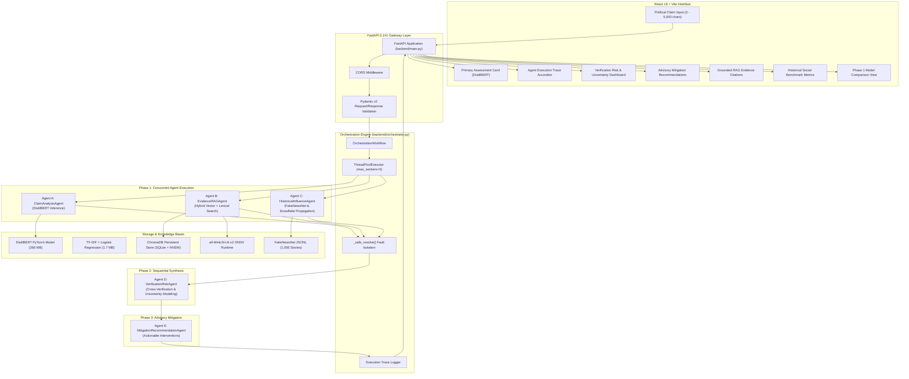

# AI-Powered Agentic System for Political Misinformation Detection, Influence Analysis and Propagation Mitigation

[](https://fastapi.tiangolo.com)
[](https://react.dev)
[](https://pytorch.org)
[](https://www.trychroma.com)
[](https://docs.pytest.org)
[](LICENSE)

An academic and production-ready decision-support system designed to analyze political claims, retrieve historical fact-checking evidence via persistent Hybrid RAG, evaluate historical social influence patterns via Twitter Snowflake decoding, and formulate responsible, non-coercive mitigation advisories through a coordinated 5-agent architecture.

---

## Table of Contents
1. [Project Overview](#1-project-overview)
2. [Problem Statement](#2-problem-statement)
3. [Objectives](#3-objectives)
4. [Key Features](#4-key-features)
5. [System Architecture](#5-system-architecture)
6. [Multi-Agent Architecture & Specialized Roles](#6-multi-agent-architecture--specialized-roles)
7. [Technology Stack](#7-technology-stack)
8. [Dataset Descriptions & Boundaries](#8-dataset-descriptions--boundaries)
9. [Machine Learning Models & Calibration](#9-machine-learning-models--calibration)
10. [Hybrid RAG (Retrieval-Augmented Generation)](#10-hybrid-rag-retrieval-augmented-generation)
11. [Historical Influence & Snowflake Propagation](#11-historical-influence--snowflake-propagation)
12. [Project Repository Structure](#12-project-repository-structure)
13. [Prerequisites](#13-prerequisites)
14. [Backend Installation & Execution](#14-backend-installation--execution)
15. [Frontend Installation & Execution](#15-frontend-installation--execution)
16. [Environment Variable Configuration](#16-environment-variable-configuration)
17. [Model and Dataset Setup Instructions](#17-model-and-dataset-setup-instructions)
18. [API Endpoint Documentation](#18-api-endpoint-documentation)
19. [Testing & Verification](#19-testing--verification)
20. [Known Limitations](#20-known-limitations)
21. [Team Contributions](#21-team-contributions)
22. [Future Scope](#22-future-scope)
23. [Academic Project Disclaimer](#23-academic-project-disclaimer)

---

## 1. Project Overview

Political misinformation often blends half-truths, selective omissions, and polarizing rhetoric. Traditional automated verification tools either rely on black-box sequence models that provide ungrounded binary labels, or on generic large language model (LLM) APIs that hallucinate unverified claims.

This project delivers an end-to-end multi-agent framework that combines:
- **Linguistic Classification**: A fine-tuned DistilBERT 6-class veracity model calibrated on the official LIAR benchmark.
- **Empirical Grounding**: A local persistent Hybrid RAG engine (ChromaDB + TF-IDF) searching published PolitiFact rulings from the LIAR-PLUS benchmark.
- **Social Influence Indicators**: Empirical benchmark matching and Twitter Snowflake bit-shift timestamp decoding from FakeNewsNet.
- **Synthetic Reasoning & Governance**: A cross-agent verification agent that detects model-evidence discrepancies, quantifies continuous uncertainty, and outputs actionable, non-coercive mitigation guidance.

---

## 2. Problem Statement

Detecting political misinformation poses unique academic and engineering challenges:
1. **Nuanced Veracity**: Political statements are rarely completely true or completely false. A binary True/False model fails to capture half-truths, technical exaggerations, or out-of-context statistics.
2. **Lack of Evidence Attribution**: Black-box classifiers output labels without explaining why or citing primary sources.
3. **Temporal Invariance**: Machine learning weights represent frozen historical parameters and cannot independently verify contemporary developments.
4. **Censorship & Ethics**: Automated content deletion by AI introduces severe constitutional and algorithmic bias risks. Systems must provide transparent decision-support rather than autonomous censorship.

---

## 3. Objectives

- **Develop a 6-Class Veracity Classifier**: Fine-tune DistilBERT on the LIAR dataset across `pants-fire`, `false`, `barely-true`, `half-true`, `mostly-true`, and `true`.
- **Implement a Persistent Hybrid RAG Pipeline**: Fuse dense ONNX semantic vector search with sparse lexical TF-IDF retrieval over the LIAR-PLUS corpus.
- **Extract Temporal Social Signals Deterministically**: Decode 64-bit Twitter Snowflake IDs to calculate first 24-hour propagation volumes and empirical viral percentiles from FakeNewsNet without external API dependencies.
- **Orchestrate Parallel Agentic Workflows**: Coordinate specialized agents concurrently via Python thread pools with fault isolation.
- **Deliver an Interactive Interface**: Provide a responsive React 19 user interface visualizing hero verdicts, diagnostic execution traces, uncertainty meters, and mitigation advisories.

---

## 4. Key Features

- **Fine-Grained Veracity Rating**: 6-level spectrum with calibrated softmax confidence bars.
- **Dual-Model Comparative Mode (Phase 1)**: Side-by-side comparison between DistilBERT and the classical TF-IDF + Logistic Regression baseline.
- **Hybrid Score Fusion**: Balances semantic abstraction with lexical precision ($\alpha \cdot S_{\text{sem}} + (1-\alpha) \cdot S_{\text{lex}}$).
- **TSV Row-Shift Anomaly Detection**: Programmatically flags upstream scraping errors in source datasets.
- **Snowflake Bit-Shift Mathematics**: Offline timestamp decoding for Twitter IDs created after November 2010.
- **Cross-Agent Contradiction Detection**: Explicitly alerts reviewers when classifier predictions contradict historical fact-checks.
- **Non-Coercive Mitigation Engine**: Actionable editorial recommendations (banners, reviews, friction advisories) with zero automated content removal.
- **Collapsible Diagnostic Trace**: Complete visibility into per-agent execution times (ms), status codes, and sub-task outputs.

---

## 5. System Architecture



---

## 6. Multi-Agent Architecture & Specialized Roles

The multi-agent system divides responsibilities across 5 modular agents coordinated by [`OrchestrationWorkflow`](file:///c:/Users/gpshu/OneDrive/Desktop/Misinformation-Detection-System/backend/orchestrator.py):

| Agent Name | Class | Execution Phase | Core Function |
| :--- | :--- | :--- | :--- |
| **Agent A** | [`ClaimAnalysisAgent`](file:///c:/Users/gpshu/OneDrive/Desktop/Misinformation-Detection-System/backend/agents.py) | Phase 1 (Concurrent) | Evaluates claim text via DistilBERT, generates 6-class softmax probabilities, maps output to semantic risk categories, and provides a confidence calibration disclaimer. |
| **Agent B** | [`EvidenceRAGAgent`](file:///c:/Users/gpshu/OneDrive/Desktop/Misinformation-Detection-System/backend/agents.py) | Phase 1 (Concurrent) | Executes hybrid search over the persistent LIAR-PLUS vector index, performs TSV row-alignment verification, formats citations, and generates a grounded evidence synthesis report. |
| **Agent C** | [`HistoricalInfluenceAgent`](file:///c:/Users/gpshu/OneDrive/Desktop/Misinformation-Detection-System/backend/agents.py) | Phase 1 (Concurrent) | Matches claims against 1,056 FakeNewsNet headlines, decodes 64-bit Twitter Snowflake timestamps, computes first 24h tweet volumes, and calculates empirical percentiles among fake and real stories. |
| **Agent D** | [`VerificationRiskAgent`](file:///c:/Users/gpshu/OneDrive/Desktop/Misinformation-Detection-System/backend/agents.py) | Phase 2 (Sequential) | Evaluates agreement/discrepancy between DistilBERT predictions and retrieved historical PolitiFact rulings, checks dataset integrity flags, and synthesizes overall Risk Level and Uncertainty Score (0.0 to 1.0). |
| **Agent E** | [`MitigationRecommendationAgent`](file:///c:/Users/gpshu/OneDrive/Desktop/Misinformation-Detection-System/backend/agents.py) | Phase 3 (Sequential) | Formulates prioritized advisory intervention cards (`Contextual Fact-Check Banners`, `Human Editorial Review`, `Propagation Friction Advisories`) with explicit non-censorship disclaimers. |

### Concurrency and Fault Tolerance
- **Thread Pool:** Agents A, B, and C execute in parallel via `concurrent.futures.ThreadPoolExecutor(max_workers=3)`.
- **Fault Isolation:** The `_safe_resolve` wrapper intercepts uncaught exceptions from sub-agents. If an individual agent crashes, it is logged with `"status": "failed"` in the execution trace, while surviving agents allow the pipeline to complete gracefully.

---

## 7. Technology Stack

### Backend
- **Python:** 3.10 to 3.13 (Core runtime)
- **FastAPI:** 0.141.1 (High-performance ASGI framework)
- **Uvicorn:** 0.54.0 (ASGI server)
- **Pydantic:** 2.13.5 (Data validation and type safety)
- **PyTorch:** 2.14.0 (Deep learning inference engine)
- **Hugging Face Transformers:** 5.17.0 (DistilBERT architecture and WordPiece tokenizer)
- **Scikit-learn:** 1.9.1 (TF-IDF vectorizers, Logistic Regression, cosine similarity)
- **ChromaDB:** 1.5.9 (Local persistent vector database with HNSW indexing)
- **ONNX Runtime:** 1.31.1 (Offline local sentence embedding generation)
- **HTTPX:** 0.28.1 (Asynchronous HTTP client for opt-in LLM synthesis)

### Frontend
- **React:** 19.2.8 (Component-based reactive UI)
- **Vite:** 8.3.0 (Fast ES-module development and production bundling)
- **CSS3:** Custom modular styles using CSS variables, flexbox, and grid layouts
- **Oxlint:** 1.81.0 (High-speed JavaScript/JSX static analysis)

---

## 8. Dataset Descriptions & Boundaries

| Dataset | Primary Source | Scope in This Project | Verified Limitations & Boundaries |
| :--- | :--- | :--- | :--- |
| **LIAR** | William Yang Wang (ACL 2017) | 12,836 statements used for DistilBERT fine-tuning and baseline model training. | Highly nuanced 6-class spectrum; human fact-checking subjectivity. |
| **LIAR-PLUS** | Alhindi et al. (NAACL 2018) | 10,240 training records enriched with PolitiFact's published ruling justifications for Hybrid RAG. | Documented upstream scraping row-shift defects in 10-14% of raw records; handled via `check_claim_justification_alignment()`. |
| **FakeNewsNet** | Kai Shu et al. (KDD 2020) | 1,056 political news stories (432 fake, 624 real) and 583,516 tweet IDs for social benchmarking. | **Contains ONLY tweet ID strings.** Does NOT contain follower counts, impression data, retweet trees, or live cascade graphs. |

---

## 9. Machine Learning Models & Calibration

### Primary Classifier: Fine-Tuned DistilBERT
- **Base Architecture:** `distilbert-base-uncased` (6 Transformer layers, 12 attention heads, hidden dimension 768, 66.4M parameters).
- **Weights:** Saved in safetensors format (`models/distilbert_liar_final/model.safetensors`, 267.8 MB).
- **Inference:** Evaluated in `eval()` mode with `torch.no_grad()`. Logits are converted to calibrated probabilities using Softmax:
  $$\sigma(\mathbf{z})_i = \frac{e^{z_i}}{\sum_{j=0}^{5} e^{z_j}}$$
- **Confidence vs Truth:** Model confidence reflects statistical similarity to training text patterns, not independent real-world truth.

### Classical Baseline: TF-IDF + Logistic Regression
- **Vectorizer:** Sublinear TF scaling ($1 + \log(\text{tf})$), unigram/bigram range $(1, 2)$, max 30,000 features.
- **Model:** Multinomial Logistic Regression (`models/baseline_model.pkl`) with calibrated probability output for comparative benchmarking.

---

## 10. Hybrid RAG (Retrieval-Augmented Generation)

To overcome the static limitations and hallucination risks of pure classification models, the system incorporates a persistent Hybrid RAG engine:

1. **Dense Semantic Retrieval:**
   - Embeds query claims using `all-MiniLM-L6-v2` via ONNX runtime (384-dimensional dense vectors).
   - Searches local persistent ChromaDB collection using approximate nearest neighbors (HNSW).
   - Transforms cosine distance $d$ to similarity: $\text{Score}_{\text{sem}} = \max(0.0, \min(1.0, 1.0 - d))$.
2. **Sparse Lexical Retrieval:**
   - In-memory `TfidfVectorizer` indexing training-split claims only (`include_splits=("train",)`) to prevent evaluation data leakage.
3. **Hybrid Score Fusion:**
   $$\text{Score}_{\text{hybrid}} = \alpha \cdot \text{Score}_{\text{sem}} + (1 - \alpha) \cdot \text{Score}_{\text{lex}}$$
   (Configurable $\alpha \in [0.0, 1.0]$, default $\alpha = 0.5$).
4. **Grounded Summary Synthesis:**
   - **Deterministic Fallback (Default):** Synthesizes consensus/divergence metrics, top statement IDs, and historical verdicts without external API calls.
   - **Opt-in LLM Synthesis:** Invokes Gemini 1.5 Flash or GPT-4o-mini if `GEMINI_API_KEY` or `OPENAI_API_KEY` is configured in the environment.

---

## 11. Historical Influence & Snowflake Propagation

The historical influence analyzer benchmarks claims against viral political news stories from FakeNewsNet:
- **Headline Matching:** TF-IDF cosine similarity matching against 1,056 historical PolitiFact news headlines (`min_score = 0.08`).
- **Deterministic Snowflake Decoding:** Decodes 64-bit Twitter IDs using bit-shift arithmetic without querying external APIs:
  $$\text{Timestamp}_{\text{ms}} = (\text{Tweet\_ID} \gg 22) + 1288834974657$$
  (Where $1288834974657\text{ ms}$ is the Twitter Epoch offset: Nov 4, 2010 01:42:54.657 UTC).
- **Propagation Metrics:** First 24-hour volume, percentage of early engagement, observed temporal span in hours/days, and peak activity dates.
- **Empirical Percentiles:** Computes exact percentile rank within fake ($N=432$) and real ($N=624$) baseline distributions.

---

## 12. Project Repository Structure

```
Misinformation-Detection-System/
├── .gitattributes                          # Standardized cross-platform line endings
├── .gitignore                              # Comprehensive exclusions (models, data, caches)
├── .env.example                            # Configuration template with placeholder variables
├── README.md                               # Master technical documentation
├── GITHUB_UPLOAD_CHECKLIST.md              # Git release and hygiene verification guide
│
├── backend/                                # FastAPI application & inference services
│   ├── main.py                             # API routes, CORS, Pydantic schemas, root app
│   ├── orchestrator.py                     # Central OrchestrationWorkflow & ThreadPool
│   ├── agents.py                           # Agents A, B, C, D, and E implementations
│   ├── rag_engine.py                       # Persistent ChromaDB vector store & hybrid search
│   ├── evidence_retriever.py               # In-memory TF-IDF lexical retriever & TSV checks
│   ├── influence_analyzer.py               # FakeNewsNet matcher & Snowflake decoder
│   └── requirements.txt                    # Python dependencies
│
├── frontend/                               # React 19 + Vite single-page application
│   ├── src/
│   │   ├── App.jsx                         # Main dashboard & all 10 specialized UI components
│   │   ├── App.css                         # Custom styling, CSS variables, responsive design
│   │   ├── main.jsx                        # React root entry point
│   │   ├── index.css                       # Base layout reset
│   │   └── assets/                         # SVG icons and visual assets
│   ├── public/                             # Static assets
│   ├── package.json                        # Node dependencies and build scripts
│   ├── package-lock.json                   # Deterministic package lock
│   ├── vite.config.js                      # Vite server and build configuration
│   └── .env.example                        # Frontend environment template
│
├── notebooks/                              # Jupyter research & training notebooks
│   ├── 01_eda.ipynb                        # LIAR exploratory data analysis
│   ├── 02_preprocessing.ipynb              # Text cleaning and tokenization pipelines
│   ├── 03_baseline_model.ipynb             # TF-IDF + Logistic Regression training
│   └── 04_distilbert_training.ipynb        # DistilBERT sequence classifier fine-tuning
│
├── scripts/                                # Standalone data preprocessing pipelines
│   └── data_preprocessing/
│       ├── preprocess_liar_plus.py         # TSV parser for LIAR-PLUS evidence
│       ├── preprocess_fakenewsnet.py       # CSV and metadata parser for FakeNewsNet
│       └── run_pipeline.py                 # Master pipeline execution script
│
├── project_audit/                          # Academic documentation & viva defense guides
│   ├── PROJECT_ARCHITECTURE_AUDIT.md       # Comprehensive system architecture analysis
│   ├── THREE_MEMBER_WORK_DIVISION.md       # Balanced team work allocation & matrices
│   ├── IMPLEMENTATION_ISSUES.md             # Prioritized technical debt & issue tracker
│   ├── MEMBER_1_LEARNING_GUIDE.md          # Machine learning lead syllabus & 15 viva Q&As
│   ├── MEMBER_2_LEARNING_GUIDE.md          # RAG & data lead syllabus & 15 viva Q&As
│   ├── MEMBER_3_LEARNING_GUIDE.md          # Orchestrator & UI lead syllabus & 15 viva Q&As
│   ├── COMMON_PROJECT_VIVA_GUIDE.md        # Master 20-question project defense guide
│   └── TESTING_CHECKLIST.md                # Verification commands & demonstration scenarios
│
└── tests/                                  # Automated pytest verification suite (57 tests)
    ├── test_rag_and_agents.py              # ChromaDB, Hybrid RAG, and Agents A–E tests
    ├── test_evidence_retrieval.py          # TF-IDF indexing, split isolation, & TSV checks
    ├── test_influence_analysis.py          # Snowflake decoding & percentile tests
    ├── test_frontend_backend_integration.py# FastAPI endpoint contracts & error tests
    └── test_preprocessed_data.py           # Dataset schema and completeness tests
```

---

## 13. Prerequisites

- **Operating System:** Windows 10/11, macOS (12+), or Ubuntu Linux (20.04+)
- **Python:** Version 3.10, 3.11, 3.12, or 3.13
- **Node.js:** Version 18.x, 20.x, or 22.x with `npm`
- **RAM:** Minimum 8 GB (16 GB recommended for concurrent indexing)
- **Disk Space:** ~5 GB free disk space for models and datasets

---

## 14. Backend Installation & Execution

### 1. Create and Activate Virtual Environment
```bash
# From project root
python -m venv backend/venv

# Windows (PowerShell)
.\backend\venv\Scripts\activate

# macOS / Linux
source backend/venv/bin/activate
```

### 2. Install Python Dependencies
```bash
pip install -r backend/requirements.txt
```

### 3. Start the FastAPI Inference Server
```bash
uvicorn backend.main:app --host 127.0.0.1 --port 8000 --reload
```
The API documentation will be available at: `http://127.0.0.1:8000/docs`

---

## 15. Frontend Installation & Execution

### 1. Install Node Dependencies
```bash
cd frontend
npm install
```

### 2. Launch Vite Development Server
```bash
npm run dev
```
The user interface will be available at: `http://localhost:5173`

---

## 16. Environment Variable Configuration

Copy the provided root `.env.example` file to `.env`:
```bash
cp .env.example .env
```

Available variables:
| Variable | Default Value | Description |
| :--- | :--- | :--- |
| `HOST` | `127.0.0.1` | FastAPI listening IP address |
| `PORT` | `8000` | FastAPI listening port |
| `ALLOWED_ORIGINS` | `http://localhost:5173,http://127.0.0.1:5173` | Permitted frontend origins for CORS |
| `GEMINI_API_KEY` | *(Empty)* | Optional Google Gemini key for LLM-grounded evidence summaries |
| `OPENAI_API_KEY` | *(Empty)* | Optional OpenAI key for LLM-grounded evidence summaries |
| `VITE_API_URL` | `http://127.0.0.1:8000` | Frontend backend connection URL |

---

## 17. Model and Dataset Setup Instructions

Because large model weights and dataset archives exceed GitHub's file-size limits, they are excluded from the repository via `.gitignore`. Follow these steps to prepare the local environment:

### 1. Datasets Placement
Place the raw benchmark datasets into the following directories:
- **LIAR:** Place `train.tsv`, `valid.tsv`, and `test.tsv` under `dataset/liar/`.
- **LIAR-PLUS:** Place `train2.tsv`, `val2.tsv`, and `test2.tsv` under `dataset/politifact_evidence/raw/`.
- **FakeNewsNet:** Place `politifact_fake.csv` and `politifact_real.csv` under `dataset/fakenewsnet/raw/`.

Execute the preprocessing pipeline to generate clean JSONL files:
```bash
python scripts/data_preprocessing/run_pipeline.py
```

### 2. Machine Learning Models
- **Baseline Models:** Run `notebooks/03_baseline_model.ipynb` to generate `models/baseline_model.pkl` and `models/tfidf_vectorizer.pkl`.
- **DistilBERT Weights:** Fine-tune using `notebooks/04_distilbert_training.ipynb` to save weights into `models/distilbert_liar_final/` (`model.safetensors`, `config.json`, `tokenizer.json`).

### 3. ChromaDB Vector Store Initialization
Initialize the persistent ChromaDB collection by running:
```bash
python backend/rag_engine.py
```
This automatically parses `train_evidence.jsonl`, generates dense embeddings via ONNX Runtime, and persists the index in `dataset/politifact_evidence/chroma_db/`.

---

## 18. API Endpoint Documentation

| Method | Endpoint | Request Payload | Response Summary |
| :--- | :--- | :--- | :--- |
| `GET` | `/` | None | API title, online status, active models list. |
| `GET` | `/health` | None | Hardware device (`cpu`/`cuda`), loaded model flags. |
| `POST` | `/predict` | `{"claim": str}` | Standalone DistilBERT label and confidence. |
| `POST` | `/compare` | `{"claim": str}` | Side-by-side DistilBERT vs Baseline predictions. |
| `POST` | `/evidence/search` | `{"claim": str, "top_k": int, "min_score": float}` | TF-IDF historical evidence search with disclaimers. |
| `GET` | `/evidence/stats` | None | Record counts, split distributions, vocabulary size. |
| `POST` | `/influence/analyze` | `{"claim": str, "top_k": int, "min_score": float}` | Matched FakeNewsNet stories and Snowflake metrics. |
| `GET` | `/influence/stats` | None | Corpus distribution baselines and percentiles. |
| `POST` | `/agent/analyze` | `{"claim": str, "top_k_evidence": int, "top_k_influence": int}` | Full 5-agent orchestration report and execution trace. |
| `GET` | `/rag/stats` | None | ChromaDB persistent store collection statistics. |

---

## 19. Testing & Verification

The project includes an automated test suite containing **57 passing test cases**:

```bash
# Run the complete test suite
pytest -v

# Run only RAG and Agent tests
pytest tests/test_rag_and_agents.py -v

# Run only Twitter Snowflake and Influence tests
pytest tests/test_influence_analysis.py -v

# Run frontend static analysis and production build
cd frontend
npm run lint
npm run build
```

---

## 20. Known Limitations

- **No Real-Time Retweet Cascades:** FakeNewsNet contains static tweet ID strings; it does NOT record live follower graphs, user impressions, or dynamic diffusion cascades.
- **Curated Benchmark Retrieval:** RAG evidence citations originate strictly from the LIAR-PLUS historical PolitiFact dataset; the system does not crawl uncurated live web search engines.
- **Statistical Confidence Bounds:** Deep learning classifier confidence indicates stylistic and lexical proximity to training patterns, not absolute proof of factual truth.
- **Historical Temporal Boundaries:** PolitiFact and FakeNewsNet benchmark events span 2008 to 2018; breaking contemporary 2026 political events will correctly trigger `UNVERIFIED_MODEL_ONLY`.

---

## 21. Team Contributions

| Team Member | Engineering Role | Key Technical Deliverables | Viva Defense Specialization |
| :--- | :--- | :--- | :--- |
| **Member 1** | Machine Learning & Claim Intelligence | DistilBERT 6-class fine-tuning, TF-IDF baseline, softmax confidence calibration, Agent A implementation, ML evaluation notebooks. | Transformer self-attention, distillation loss, 6-class LIAR taxonomy, confidence calibration. |
| **Member 2** | Hybrid RAG & Historical Intelligence | ChromaDB persistent vector store, ONNX embeddings, hybrid score fusion ($\alpha=0.5$), TSV row-shift checks, FakeNewsNet Snowflake decoding, Agent B & C. | Vector search (HNSW), cosine mathematics, Snowflake bit-shift decoding, empirical percentiles. |
| **Member 3** | Orchestration, Risk & Full-Stack | Central orchestrator workflow, `ThreadPoolExecutor` concurrency, Agent D cross-agent synthesis, Agent E mitigation engine, FastAPI gateway, React 19 UI. | Multi-agent concurrency, exception isolation (`_safe_resolve`), uncertainty scoring, ethical AI mitigation. |

*(Detailed individual learning guides and viva preparation syllabi are available in [`project_audit/`](file:///c:/Users/gpshu/OneDrive/Desktop/Misinformation-Detection-System/project_audit/)).*

---

## 22. Future Scope

1. **Graph Neural Networks (GNNs) for Propagation Cascades**: Incorporating complete Twitter follower and retweet network topologies to model viral misinformation cascades via Graph Convolutional Networks (GCNs).
2. **Continuous Live Document Ingestion**: Connecting the RAG vector store to official legislative feeds (e.g., Congressional Records, Reuters API, AP News) for real-time verification of breaking political claims.
3. **Logit Calibration & Temperature Scaling**: Applying Platt scaling or temperature scaling on the validation split to further improve the probabilistic calibration of DistilBERT predictions.

---

## 23. Academic Project Disclaimer

This software system was developed as a college major project for academic demonstration and research purposes. All mitigation recommendations generated by the system are strictly advisory decision-support guidance. The system does not remove content, restrict user accounts, or intervene in live publication workflows.
