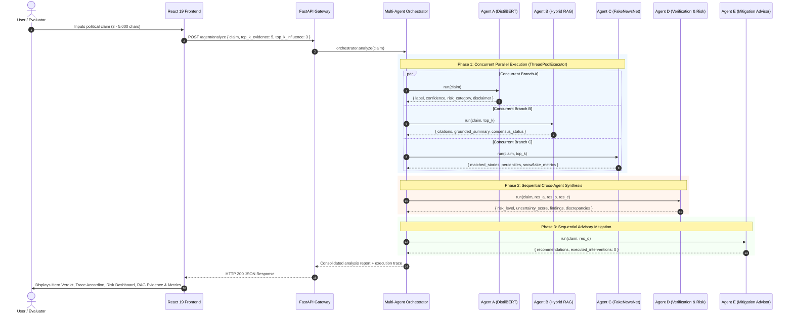

# Common Project Viva Guide & Master System Defense

**Project Title:** AI-Powered Agentic System for Political Misinformation Detection, Influence Analysis and Propagation Mitigation  
**Audience:** All 3 Team Members (Common Academic Grounding)  
**Scope:** End-to-End System Integration, Dataset Provenance, Architecture Trade-offs, Ethical Boundaries, and Viva Defense  

---

## 1. Master Project Elevator Pitch (30-Second Summary)

> "Our project is an end-to-end decision-support system designed to detect and mitigate political misinformation. Rather than relying solely on a black-box deep learning classifier, our system couples a fine-tuned DistilBERT 6-class sequence model with a persistent Hybrid RAG engine that retrieves published PolitiFact fact-checks from the LIAR-PLUS benchmark. Concurrently, it extracts historical social engagement indicators and Twitter Snowflake temporal metrics from FakeNewsNet. A 5-agent orchestration pipeline cross-verifies these signals in parallel, computes a continuous uncertainty score, flags model-evidence discrepancies, and generates prioritized, non-coercive mitigation advisories. The entire workflow is accessible through a responsive React 19 interface backed by a high-performance FastAPI service."

---

## 2. End-to-End Dataflow Walkthrough

---

## 3. Dataset Comparative Matrix

| Feature | LIAR Dataset | LIAR-PLUS Dataset | FakeNewsNet (PolitiFact) |
| :--- | :--- | :--- | :--- |
| **Origin / Publication** | William Yang Wang (ACL 2017) | Alhindi, Gregor, Muresan (NAACL 2018) | Shu, Mahudeswaran, Wang, Liu (SIGKDD 2020) |
| **Primary Content** | Short political statements collected from PolitiFact. | Statements enriched with PolitiFact's published ruling justifications. | News article headlines, URLs, and associated tweet ID arrays. |
| **Total Corpus Size** | 12,836 records | 12,836 records | 1,056 news stories (432 fake, 624 real) |
| **Split Structure** | Train (10,240), Val (1,284), Test (1,267) | Train (10,240), Val (1,284), Test (1,267) | Benchmark collection (unsplit) |
| **Veracity Labels** | 6 classes (`pants-fire`, `false`, `barely-true`, `half-true`, `mostly-true`, `true`) | 6 classes (same as LIAR) | Binary (`fake` vs `real`) |
| **Additional Metadata** | Speaker, job title, state, party affiliation, context | Speaker, context, party + **Extracted Justification Text** | Article title, source URL, 583,516 tweet IDs |
| **System Role** | Model training & baseline evaluation (Member 1). | Dense ChromaDB vector store & TF-IDF evidence retrieval (Member 2). | Social engagement benchmarking & Snowflake temporal decoding (Member 2). |
| **Known Anomalies** | Highly challenging 6-class imbalance; human subjective ratings. | Upstream scraping row-shift defects in 10-14% of raw records. | Tweet IDs only; no user follower counts, impressions, or graph edges. |

---

## 4. Fundamental Architectural Trade-offs

### 4.1 Why Hybrid RAG instead of Fine-Tuning Alone?
1. **Hallucination Prevention:** Fine-tuned transformer models memorize training language patterns. When presented with contemporary political events, they hallucinate plausible-sounding rationales. Hybrid RAG provides verifiable, citable historical PolitiFact statements.
2. **Explainability & Attribution:** Classification probabilities (`85% false`) offer no human-interpretable rationale. RAG returns the exact PolitiFact ruling text and speaker background, enabling users to verify the justification.
3. **Knowledge Freshness:** Updating a classifier requires retraining or fine-tuning ($\mathcal{O}(\text{GPU hours})$). Updating a RAG knowledge base requires inserting records into ChromaDB ($\mathcal{O}(\text{milliseconds})$).

### 4.2 Why a Multi-Agent Architecture instead of a Single Monolithic Pipeline?
1. **Parallel Execution:** Decoupling classification, evidence retrieval, and influence analysis allows concurrent execution via thread pools, cutting total system latency in half.
2. **Fault Isolation:** An uncaught failure in one domain (e.g., a missing influence story) does not abort the entire system; remaining agents provide partial intelligence.
3. **Separation of Reasoning Layers:** Classifiers predict linguistic style, retrieval models find text precedents, Agent D evaluates consensus, and Agent E formulates policy. Combining these into a single black-box LLM prompt causes hallucinations and loss of auditability.

---

## 5. System Limitations & Ethical Guardrails

Every team member must be completely candid about these boundaries during viva examinations:
1. **No Real-Time Social Graph / Retweet Cascades:** FakeNewsNet contains historical tweet ID strings; it does NOT record live retweet tree cascades, diffusion graphs, or user follower networks.
2. **No Real-Time Web Search:** Historical citations originate strictly from the curated LIAR-PLUS dataset, not from live Bing or Google web search indexing.
3. **Advisory Decision Support Only:** The mitigation engine recommends informational interventions (`Contextual Fact-Check Banners`, `Human Editorial Escalation`). It explicitly does NOT remove content, ban accounts, or censor speech.
4. **Statistical Confidence $\neq$ Veracity:** DistilBERT confidence reflects statistical similarity to training texts, not empirical proof of ground truth.

---

## 6. Top 20 Common Viva Defense Questions & Answers

### Q1: What is the primary problem your project solves?
**Model Answer:**
"Political misinformation spreads rapidly and undermines democratic discourse. Existing automated detection systems typically rely on black-box classifiers that output binary labels without evidence, or on generic generative LLMs that hallucinate facts. Our project solves this by combining fine-tuned deep learning with hybrid retrieval-augmented generation (RAG) and historical social benchmarking across a 5-agent architecture that cross-verifies claims, scores uncertainty, and provides transparent, actionable mitigation advisories."

### Q2: Walk me through the lifecycle of a user request from input to final screen.
**Model Answer:**
"1. The user inputs a claim string into the React 19 UI.
2. The frontend sends a `POST /agent/analyze` request to FastAPI.
3. The orchestrator validates the claim length (3–5,000 characters).
4. Phase 1 starts: a `ThreadPoolExecutor(max_workers=3)` executes Agent A (DistilBERT inference), Agent B (Hybrid RAG search in ChromaDB + TF-IDF), and Agent C (FakeNewsNet matching + Snowflake decoding) concurrently.
5. Phase 2 starts: Agent D takes all three results, detects contradictions, and computes the risk level and uncertainty score.
6. Phase 3 starts: Agent E takes Agent D's findings and generates prioritized advisory mitigation cards.
7. FastAPI returns the consolidated report with an execution trace to the frontend, which renders the hero card, diagnostic drawer, risk dashboard, evidence citations, and propagation metrics."

### Q3: Why is the LIAR dataset formulated with 6 classes instead of binary (True/False)?
**Model Answer:**
"Real-world political discourse is nuanced. Statements frequently contain factual data presented with misleading omissions or distorted context. The 6-class LIAR spectrum (*pants-fire*, *false*, *barely-true*, *half-true*, *mostly-true*, and *true*) captures these critical intermediate realities (*half-true* and *barely-true*) that a binary classification model would misclassify."

### Q4: How does your system determine the overall Risk Level in Agent D?
**Model Answer:**
"Agent D uses a cross-agent consensus matrix:
- If DistilBERT predicts a false-spectrum class and the top retrieved PolitiFact evidence also has a false verdict, it assigns `HIGH_MISINFORMATION_RISK` with low uncertainty (0.25).
- If DistilBERT predicts false but historical fact-checks rated the statement true, it flags `DISCREPANCY_BETWEEN_MODEL_AND_EVIDENCE` with elevated uncertainty (0.65).
- If the model predicts a label but 0 historical fact-checks exist, it assigns `UNVERIFIED_MODEL_ONLY` with high uncertainty (0.75)."

### Q5: What is the difference between dense retrieval and sparse retrieval in your RAG engine?
**Model Answer:**
"Dense retrieval (ChromaDB + `all-MiniLM-L6-v2`) compares 384-dimensional continuous semantic embeddings using cosine distance, capturing conceptual meaning and synonyms even when wording differs. Sparse retrieval (TF-IDF) compares n-gram term frequencies using lexical overlap, capturing exact entity names, acronyms, and numerical figures. Our hybrid engine fuses both scores using $\alpha=0.5$."

### Q6: What embedding model do you use, and why is it run locally via ONNX?
**Model Answer:**
"We use `all-MiniLM-L6-v2` executed locally via `onnxruntime`. Running locally via ONNX provides sub-50ms embedding generation on standard CPU hardware without depending on external cloud APIs, recurring subscription fees, or internet connectivity."

### Q7: How does your system decode Twitter Snowflake IDs without querying the Twitter API?
**Model Answer:**
"Twitter Snowflake IDs are 64-bit integers where the 41 most significant bits encode the milliseconds elapsed since the custom Twitter epoch (Nov 4, 2010 01:42:54.657 UTC). By applying the bit-shift operation `(id >> 22) + 1288834974657`, we mathematically extract the exact millisecond UTC timestamp entirely offline without needing an active Twitter/X API key."

### Q8: What are the two types of summaries generated by your RAG engine?
**Model Answer:**
"The RAG engine supports two modes:
1. **Deterministic Summary (Default):** Extracts the top matching statement ID, speaker, verdict, and hybrid similarity, while analyzing the verdict distribution across citations to flag consensus or contradiction.
2. **Opt-in LLM Summary:** If a `GEMINI_API_KEY` or `OPENAI_API_KEY` is configured in the environment, it passes the retrieved citations to Gemini 1.5 Flash or GPT-4o-mini with strict instructions to summarize strictly within the provided facts in under 120 words."

### Q9: What happens if one of the agents throws an unhandled exception during analysis?
**Model Answer:**
"The orchestrator uses an exception isolation function `_safe_resolve()`. If a subagent crashes, `_safe_resolve()` catches the exception, logs the error, marks the agent as `status: 'failed'` in the execution trace, and populates safe default empty payloads. The orchestrator continues to Phase 2 and Phase 3, ensuring the user still receives an HTTP 200 response with available intelligence rather than an unhandled 500 error."

### Q10: How does your mitigation module adhere to ethical AI guidelines?
**Model Answer:**
"Agent E formulates strictly advisory, non-coercive decision-support recommendations (such as contextual fact-check overlays and human reviewer escalation). It does not perform automated content deletion, shadowbanning, or account penalties. It outputs an explicit disclaimer affirming that zero automated interventions were executed."

### Q11: What is the upstream TSV row-shift problem in LIAR-PLUS, and how did you address it?
**Model Answer:**
"The official 2018 LIAR-PLUS dataset contains scraping errors where unescaped tabs and newlines shifted columns, causing justifications to dissociate from their respective claims in 10-14% of records. We addressed this by writing `check_claim_justification_alignment()`, which verifies whether speaker names or informative claim keywords appear in the justification text, surfacing a `has_context_alignment: false` warning in the UI if an anomaly is detected."

### Q12: Why do you provide a Phase 1 Comparison section in your frontend?
**Model Answer:**
"The Phase 1 comparison section allows evaluators to directly compare the predictions and confidence scores of our fine-tuned DistilBERT transformer against the classical TF-IDF + Logistic Regression baseline side-by-side, visually demonstrating the architectural progression of our project."

### Q13: What hardware environment is required to run this project?
**Model Answer:**
"The entire system is optimized to run on standard commodity laptop hardware (Windows, macOS, or Linux) with a quad-core CPU and 8GB to 16GB of RAM. Neither CUDA nor GPU acceleration is strictly required because DistilBERT, ChromaDB, ONNX embeddings, and TF-IDF all operate efficiently on CPU."

### Q14: What is the purpose of the empirical percentile rank in the influence analyzer?
**Model Answer:**
"Raw tweet counts (e.g., 250 tweets) lack context. The empirical percentile rank tells us where that tweet volume stands relative to historical PolitiFact stories in FakeNewsNet. A count of 250 tweets might place a story in the 75th percentile of fake stories, indicating unusually high viral social propagation within that benchmark."

### Q15: How many automated tests exist in your project, and what do they verify?
**Model Answer:**
"Our automated test suite contains 57 passing pytest unit and integration tests across 5 test modules. They verify ChromaDB vector indexing, hybrid score fusion, LLM grounded summary fallbacks, Snowflake ID bit-shift decoding, split isolation, FastAPI endpoints, Pydantic validation, and multi-agent fault isolation."

### Q16: Can this system be used to verify breaking political news published 5 minutes ago?
**Model Answer:**
"The system will classify the linguistic patterns of the breaking claim using DistilBERT. However, because our RAG engine is indexed on the LIAR-PLUS historical benchmark and does not perform live web scraping, it will report 0 historical citations and Agent D will correctly output `UNVERIFIED_MODEL_ONLY`. This demonstrates transparent failure handling rather than false confidence."

### Q17: What is the time complexity of the orchestrator pipeline?
**Model Answer:**
"Phase 1 has time complexity $\mathcal{O}(\max(T_A, T_B, T_C))$, where $T_A$ is DistilBERT inference ($\approx 40\text{ms}$), $T_B$ is hybrid vector search ($\approx 60\text{ms}$), and $T_C$ is headline matching and Snowflake decoding ($\approx 25\text{ms}$). Because they run concurrently in a thread pool, Phase 1 completes in $\approx 60-70\text{ms}$. Phases 2 and 3 execute rule-based synthesis in $<5\text{ms}$. The total pipeline completes in approximately 80 to 120 milliseconds on CPU."

### Q18: What is the difference between Accuracy and Macro F1 on the LIAR dataset?
**Model Answer:**
"Accuracy measures the overall fraction of correct predictions across all samples. Macro F1 calculates the unweighted mean of the F1 scores for each of the 6 veracity classes independently. In datasets with class imbalance, Macro F1 is the more rigorous academic metric because a model cannot achieve a high score simply by over-predicting the majority class."

### Q19: Why did you build the frontend in React 19 instead of standard HTML templates (like Jinja2)?
**Model Answer:**
"React 19 enables a modern, responsive single-page application with reactive state transitions. Complex features like the collapsible agent execution trace accordion, dynamic uncertainty meters, paginated historical evidence cards, and side-by-side model comparisons require modular client-side component state that Jinja2 server-rendered templates cannot provide smoothly."

### Q20: What are the three most significant future enhancements for this project?
**Model Answer:**
"1. **Graph-Based Propagation Cascades:** Ingesting full Twitter retweet network edges to construct dynamic cascade graphs and compute graph topology metrics (e.g., betweenness centrality, Wiener index).
2. **Live Web RAG Ingestion:** Integrating a curated live news and government document ingestion pipeline (e.g., Congressional Records, Reuters, AP) to ground breaking claims in real-time.
3. **Calibrated Temperature Scaling:** Applying Platt scaling or temperature scaling to DistilBERT logits on the validation split to further improve probabilistic calibration."

