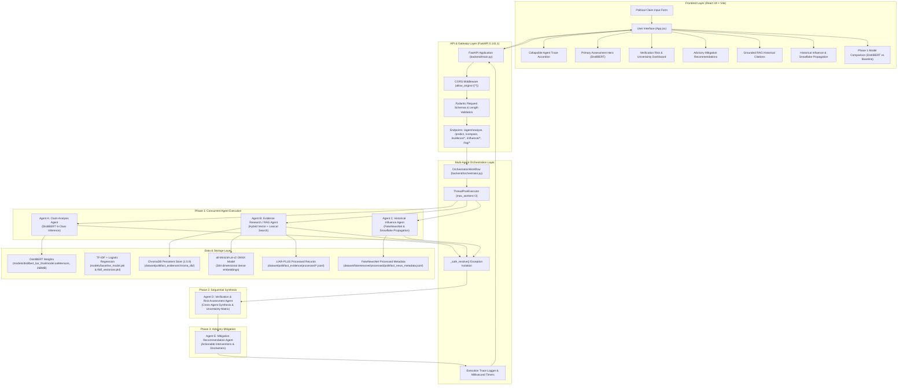

# Complete Project Architecture Audit

**Project Title:** AI-Powered Agentic System for Political Misinformation Detection, Influence Analysis and Propagation Mitigation  
**Academic Level:** College Major Project (Final Year B.Tech / B.E.)  
**Audit Date:** November 2026  
**Status:** Implementation-Level Exhaustive Audit

---

## Executive Summary

This document presents a comprehensive, evidence-based architectural audit of the **AI-Powered Agentic System for Political Misinformation Detection, Influence Analysis and Propagation Mitigation**. Every component, module, dataset, API endpoint, and mathematical formula documented herein reflects the actual source code and data assets present in the repository.

The application is fully operational as a unified full-stack system comprising:
1. **Frontend:** React 19 + Vite single-page application (`frontend/src/App.jsx`, `frontend/src/App.css`).
2. **Backend API:** FastAPI 0.141.1 service with Uvicorn and Pydantic validation (`backend/main.py`).
3. **Machine Learning Pipeline:** Fine-tuned DistilBERT 6-class sequence classifier and TF-IDF baseline (`models/`).
4. **Hybrid RAG Engine:** Persistent ChromaDB vector database with ONNX embeddings and TF-IDF lexical search (`backend/rag_engine.py`, `backend/evidence_retriever.py`).
5. **Historical Influence Analyzer:** FakeNewsNet empirical benchmarking and 64-bit Twitter Snowflake ID temporal propagation decoding (`backend/influence_analyzer.py`).
6. **Multi-Agent Orchestrator:** 5 specialized agents executing across concurrent and sequential phases with fault isolation (`backend/agents.py`, `backend/orchestrator.py`).

---

## 1. System Architecture Diagram



---

## 2. Frontend Architectural Audit

### 2.1 Technology Stack & Build Pipeline
- **Framework:** React 19.x with functional components and React Hooks (`useState`, `useEffect`, `useCallback`).
- **Build Tool:** Vite 6.x configured for fast ES-module HMR and bundling.
- **Styling:** Modular vanilla CSS in `frontend/src/App.css` utilizing modern CSS variables for theme consistency, flexbox/grid layouts, responsive breakpoints (`@media (max-width: 768px)`), and accessibility standards.
- **Linter & Verification:** Oxlint and Vite production build (`vite build` completes cleanly with 0 errors).

### 2.2 Component Hierarchy & Responsibilities

| Component Name | Source Location | Description & Responsibilities |
| :--- | :--- | :--- |
| `App` | `App.jsx:1446` | Root state coordinator. Manages input text, active analysis results, asynchronous fetch states, collapsible section toggles, query history, and system error boundaries. |
| `PrimaryAssessmentSection` | `App.jsx:157` | High-visibility hero banner presenting the primary veracity assessment. Renders DistilBERT label, color-coded level badges (Levels 1–6), calibrated confidence percentage bar, semantic risk category, and benchmark calibration disclaimer. |
| `AgentExecutionTraceSection` | `App.jsx:266` | Collapsible diagnostic accordion displaying execution traces for all 5 specialized agents. Shows individual execution durations (ms), completion status badges (`completed` vs `failed`), operation summaries, and error logs. |
| `VerificationRiskSection` | `App.jsx:369` | Uncertainty and risk dashboard. Visualizes synthesized Risk Level badge (`HIGH_MISINFORMATION_RISK`, `DISCREPANCY`, `UNVERIFIED`, etc.), Uncertainty Meter (0–100%), bulleted factual findings, identified uncertainty factors, and upstream TSV row-shift integrity flags. |
| `MitigationRecommendationsSection` | `App.jsx:496` | Responsible decision-support card collection. Displays prioritized mitigation actions (`Contextual Fact-Check Banner`, `Human Editorial Escalation`, `Propagation Friction Advisory`, `Primary Source Ingestion`), priority badges (`High`, `Medium`, `Low`), target audience, rationale, and a mandatory disclaimer affirming that no real-world content censorship or automated account blocking occurred. |
| `HistoricalEvidenceSection` | `App.jsx:726` | RAG evidence container. Displays grounded synthesis report, evidence status badge (`grounded`, `weak_precedent`, `insufficient`), historical verdict distribution pills, benchmark conflict warnings, and paginated `EvidenceCard` instances. |
| `EvidenceCard` | `App.jsx:583` | Renders a single retrieved LIAR-PLUS historical precedent. Displays statement ID, PolitiFact ruling verdict badge, speaker name, job title, party affiliation, publication context, hybrid similarity score (percentage), justification excerpt, and a TSV row-alignment indicator badge. |
| `HistoricalInfluenceSection` | `App.jsx:977` | Social context container. Renders summary of matched FakeNewsNet benchmark stories, benchmark baselines (median and mean tweet volume for fake vs real stories), and individual `InfluenceCard` instances. |
| `InfluenceCard` | `App.jsx:874` | Renders matched benchmark news story: historical headline, source domain, dataset label (`fake` vs `real`), observed tweet count, empirical percentiles, and Twitter Snowflake temporal breakdown (first 24h count/%, observed span, peak dates). |
| `Phase1ComparisonSection` | `App.jsx:1282` | Collapsible historical comparison section displaying side-by-side performance of DistilBERT vs the baseline TF-IDF + Logistic Regression model. |
| `AnalysisSummarySection` | `App.jsx:1151` | Synthesis summary aggregating findings across classification, evidence retrieval, and influence analysis. |
| `EvidenceLimitationsSection` | `App.jsx:1101` | Static educational card presenting dataset limitations, ethical constraints, and academic disclaimers. |

### 2.3 State Management & Data Flow
1. User enters a claim string into the textarea (validated between 3 and 5,000 characters).
2. The user submits the form, triggering `handleAnalyzeClaim()`:
   - Sets `isLoading = true`, clears previous errors.
   - Dispatches a single `POST /agent/analyze` request to the backend with payload `{ claim, top_k_evidence: 5, top_k_influence: 3 }`.
   - Simultaneously dispatches `POST /compare` to support the collapsible Phase 1 comparison view.
3. Upon response resolution:
   - Populates `agentReport` state containing full multi-agent output and execution trace.
   - Populates `comparison` state for baseline vs transformer inspection.
   - Appends the query to localStorage-backed historical analysis sessions.
   - Resets `isLoading = false`.
4. Robust error handling ensures that if the network or server fails, user-friendly alert banners are rendered without blanking the screen.

---

## 3. Backend Architectural Audit & API Specification

### 3.1 Framework & Runtime Configuration
- **Framework:** FastAPI 0.141.1 running on Uvicorn ASGI server.
- **Python Version:** Python 3.13 (compatible with 3.10+).
- **Validation:** Pydantic v2 schemas with strict field constraints (`min_length=1`, `max_length=5000`, numeric range validators).
- **CORS Middleware:** Configured with `allow_origins=["*"]`, `allow_methods=["*"]`, `allow_headers=["*"]`. (Audit note: Permissive wildcard CORS is suitable for local development but must be restricted to verified origins in production).

### 3.2 Endpoints and Data Contracts

| Method | Route | Request Body | Response Structure | Purpose |
| :--- | :--- | :--- | :--- | :--- |
| `GET` | `/` | None | `{ message, status, models }` | Service discovery and health check root. |
| `GET` | `/health` | None | `{ status, device, distilbert_loaded, baseline_loaded, tfidf_loaded }` | Hardware device and model readiness check. |
| `POST` | `/predict` | `ClaimRequest`: `{ claim: str }` | `{ claim: str, label: str, confidence: float }` | Standalone DistilBERT inference on submitted claim. |
| `POST` | `/compare` | `ClaimRequest`: `{ claim: str }` | `{ claim: str, baseline: {...}, distilbert: {...} }` | Side-by-side comparison of baseline vs DistilBERT. |
| `POST` | `/evidence/search` | `EvidenceSearchRequest`: `{ claim: str, top_k: int, min_score: float }` | `{ query, result_count, results: [...], disclaimer }` | Lexical TF-IDF evidence retrieval over LIAR-PLUS. |
| `GET` | `/evidence/stats` | None | `{ total_examined, total_indexed, total_excluded, splits, vocab_size }` | LIAR-PLUS lexical index diagnostic statistics. |
| `POST` | `/influence/analyze` | `InfluenceAnalysisRequest`: `{ claim: str, top_k: int, min_score: float }` | `{ query, result_count, results: [...], benchmark_baselines, disclaimer }` | Standalone FakeNewsNet headline matching & Snowflake analysis. |
| `GET` | `/influence/stats` | None | `{ total_stories, fake_stories_count, real_stories_count, total_tweet_ids, stats }` | FakeNewsNet benchmark distribution statistics. |
| `POST` | `/agent/analyze` | `AgentAnalysisRequest`: `{ claim: str, top_k_evidence: int, top_k_influence: int }` | Full multi-agent orchestration payload (see Section 6). | Complete 5-agent pipeline execution. |
| `GET` | `/rag/stats` | None | `{ collection_name, document_count, is_persistent, alpha, vector_store, embedding_model, lexical_stats }` | Persistent ChromaDB collection diagnostics. |

---

## 4. Machine Learning & Claim Intelligence Audit

### 4.1 Datasets & Label Topology
The classification engine operates on the benchmark **LIAR dataset** (Wang, ACL 2017), containing 12,836 short political statements collected from PolitiFact across six granular veracity classes:

$$\mathcal{C} = \{\text{pants-fire}, \text{false}, \text{barely-true}, \text{half-true}, \text{mostly-true}, \text{true}\}$$

In `backend/main.py`, the label mapping dictionary is formally defined:
```python
ID2LABEL = {
    0: "barely-true",
    1: "false",
    2: "half-true",
    3: "mostly-true",
    4: "pants-fire",
    5: "true",
}
```

### 4.2 Primary Deep Learning Classifier: DistilBERT
- **Architecture:** `distilbert-base-uncased` sequence classification head with 6 output logits.
  - Parameters: 6 Transformer layers, 12 attention heads, hidden dimension $d_h = 768$, feed-forward dimension $d_{ff} = 3072$.
  - Total parameters: $\approx 66.4\text{M}$.
  - Storage: `models/distilbert_liar_final/model.safetensors` (267.8 MB).
- **Tokenization:** WordPiece vocabulary (30,522 tokens), sequence truncation to 128 tokens, special tokens `[CLS]` and `[SEP]`.
- **Inference Pipeline:** Model evaluated in `model.eval()` mode under `torch.no_grad()`. Logits $\mathbf{z} \in \mathbb{R}^6$ are transformed into calibrated class probabilities via softmax:
  $$P(Y = i \mid \mathbf{x}) = \frac{e^{z_i}}{\sum_{j=0}^{5} e^{z_j}}$$
- **Confidence Metric:** The model confidence is defined as the maximum softmax probability:
  $$\text{Confidence} = \max_{i \in \{0..5\}} P(Y = i \mid \mathbf{x})$$
- **Calibration Disclaimer:** The system explicitly logs that statistical confidence indicates linguistic alignment with historical training distributions, NOT independent proof of real-world veracity.

### 4.3 Baseline Classifier: TF-IDF + Logistic Regression
- **Vectorizer:** `models/tfidf_vectorizer.pkl` (788 KB) with sublinear TF scaling ($1 + \log(\text{tf})$), unigram and bigram n-range $(1, 2)$, max features 30,000.
- **Model:** `models/baseline_model.pkl` (961 KB) multinomial Logistic Regression trained with L2 regularization and calibrated `predict_proba()` output.
- **Role:** Provides an interpretable, fast benchmark against which DistilBERT's non-linear contextual embeddings are compared in Phase 1 comparison mode.

---

## 5. Hybrid Retrieval-Augmented Generation (RAG) Audit

### 5.1 Architecture & Components
The RAG system combines dense semantic vector retrieval with sparse lexical retrieval to provide reliable factual grounding over the **LIAR-PLUS benchmark** (Alhindi et al., 2018):

```
                   User Query Claim
                          │
         ┌────────────────┴────────────────┐
         ▼                                 ▼
Dense Semantic Path               Sparse Lexical Path
(ChromaDB 1.5.9 Persistent)       (TF-IDF N-gram Matrix)
Embeddings: all-MiniLM-L6-v2      Features: Sublinear TF, (1,2)-grams
Metric: Cosine Distance           Metric: Cosine Similarity
Candidate Pool: Top 20            Candidate Pool: Top 20
         │                                 │
         └────────────────┬────────────────┘
                          ▼
                 Hybrid Score Fusion
    Score = α · Score_semantic + (1 - α) · Score_lexical
                   (Default α = 0.5)
                          │
                          ▼
            Upstream TSV Alignment Check
         check_claim_justification_alignment()
                          │
                          ▼
              Grounded Synthesis Report
        (Deterministic Fallback / Opt-in LLM)
```

### 5.2 Dense Semantic Vector Store (ChromaDB)
- **Engine:** `chromadb.PersistentClient` initialized at `dataset/politifact_evidence/chroma_db/`.
- **Collection Name:** `liar_plus_evidence`.
- **Indexed Records:** Currently contains **4,250 persisted claims and justifications** from `train_evidence.jsonl`.
- **Embedding Model:** Local `all-MiniLM-L6-v2` ONNX runtime model producing 384-dimensional dense vector embeddings without external network overhead.
- **Distance to Similarity Conversion:** ChromaDB records cosine distance $d \in [0, 2]$. Converted to similarity via:
  $$\text{Score}_{\text{semantic}} = \max(0.0, \min(1.0, 1.0 - d))$$

### 5.3 Sparse Lexical Retrieval (`EvidenceRetriever`)
- **Engine:** In-memory `TfidfVectorizer` (sublinear TF, ngram range (1,2), max features 30,000).
- **Corpus:** 10,240 training claims from `train_evidence.jsonl`.
- **Filtering:** Excludes validation and test splits by default (`include_splits=("train",)`) to strictly prevent evaluation data leakage.

### 5.4 Hybrid Fusion Formula
Given candidate claim $c$, its semantic similarity $S_{\text{sem}}(c)$ and lexical similarity $S_{\text{lex}}(c)$, the hybrid score is:

$$\text{Score}_{\text{hybrid}}(c) = \alpha \cdot S_{\text{sem}}(c) + (1 - \alpha) \cdot S_{\text{lex}}(c)$$

Where $\alpha \in [0.0, 1.0]$ is configurable (default $\alpha = 0.5$). Ties are broken deterministically by sorting on `statement_id`.

### 5.5 Upstream TSV Row-Shift Anomaly Detection
The original LIAR-PLUS dataset possesses documented upstream scraping discrepancies where text shifts caused justification paragraphs to dissociate from their respective claims. The method `check_claim_justification_alignment()` detects these anomalies:
```python
def check_claim_justification_alignment(claim: str, speaker: str, justification: str) -> bool:
    # 1. Checks if speaker name appears in justification text
    # 2. Checks if informative claim keywords (>4 characters, non-stopwords) appear in justification
    # Returns True if context alignment verified, False if potential row-shift detected
```
Misaligned citations are tagged with `has_context_alignment: false`, triggering integrity alerts in the UI.

### 5.6 Grounded Synthesis Engine
- **Deterministic Synthesis:** Analyzes retrieved historical verdicts, calculates consensus vs divergence, flags conflicting rulings, and generates an objective summary citing exact statement IDs.
- **Opt-in LLM Synthesis:** If `GEMINI_API_KEY` or `OPENAI_API_KEY` is present in the environment, passes retrieved citations to Gemini 1.5 Flash or GPT-4o-mini with strict 120-word grounding constraints.

---

## 6. Historical Influence Analysis Audit

### 6.1 Dataset & Corpus Statistics
The influence analyzer processes `dataset/fakenewsnet/processed/politifact_news_metadata.jsonl`:
- **Total Historical Stories:** 1,056 stories.
  - Fake-labeled stories: 432.
  - Real-labeled stories: 624.
- **Total Recorded Tweet IDs:** 583,516 tweet IDs.
- **Corpus Baselines:**
  - Fake stories: Median = 44.5 tweets, Mean = 358.3 tweets, Max = 16,817 tweets.
  - Real stories: Median = 13.0 tweets, Mean = 687.2 tweets, Max = 194,547 tweets.

### 6.2 Deterministic Twitter Snowflake ID Decoding
Tweet IDs recorded after November 4, 2010 are 64-bit integer Twitter Snowflake IDs containing encoded creation timestamps. The method `decode_snowflake_id()` performs bit-shift arithmetic:

$$\text{Timestamp}_{\text{ms}} = (\text{Tweet\_ID} \gg 22) + 1288834974657$$

Where:
- $\gg 22$ shifts right by 22 bits, extracting the 41-bit millisecond counter.
- $1288834974657$ is the Twitter epoch offset (Nov 4, 2010 01:42:54.657 UTC).

IDs are categorized into three mutually exclusive statuses:
1. `valid`: Number $\ge 30,000,000,000$ and decoded UTC year $\in [2010, 2026]$.
2. `legacy`: Pre-Snowflake sequential IDs ($< 30,000,000,000$, pre-Nov 2010).
3. `malformed`: Non-numeric, negative, or unparsable IDs.

### 6.3 Temporal Propagation & Empirical Percentiles
- **First 24-Hour Propagation:** Calculates count and percentage of valid tweet IDs posted within 24 hours of the earliest recorded tweet:
  $$\text{First 24h Pct} = \frac{N_{\le 24\text{h}}}{N_{\text{valid}}} \times 100\%$$
- **Observed Propagation Span:** Computes elapsed time in hours and days between earliest and latest recorded tweet IDs.
- **Empirical Percentile:** For a matched story with observed tweet count $v$, its empirical percentile within category $C \in \{\text{fake}, \text{real}\}$ is:
  $$\text{Percentile}(v \mid C) = \frac{\sum_{i=1}^{|C|} \mathbb{I}(c_i \le v)}{|C|} \times 100\%$$

### 6.4 Strict Data Boundaries
- **No Follower or Impression Data:** FakeNewsNet contains only tweet ID strings; it does NOT record user follower counts, impressions, or reach.
- **No Dynamic Retweet Graphs:** Network graph topologies, cascades, and diffusion edges are absent from this dataset and explicitly reserved for future work.
- **Benchmark Distinction:** Historical metrics describe matched past news articles, NEVER the submitted claim itself.

---

## 7. Multi-Agent System & Orchestrator Audit

### 7.1 Agent Roles & Responsibilities

```
                                  Claim Input
                                       │
            ┌──────────────────────────┼──────────────────────────┐
            ▼                          ▼                          ▼
      ┌───────────┐              ┌───────────┐              ┌───────────┐
      │  Agent A  │              │  Agent B  │              │  Agent C  │
      │   Claim   │              │ Evidence  │              │Historical │
      │ Analysis  │              │    RAG    │              │ Influence │
      └─────┬─────┘              └─────┬─────┘              └─────┬─────┘
            │                          │                          │
            └──────────────────────────┼──────────────────────────┘
                                       ▼
                                 ┌───────────┐
                                 │  Agent D  │
                                 │Verification│
                                 │   & Risk   │
                                 └─────┬─────┘
                                       │
                                       ▼
                                 ┌───────────┐
                                 │  Agent E  │
                                 │Mitigation │
                                 │  Advisor  │
                                 └───────────┘
```

1. **Agent A (`ClaimAnalysisAgent`):**
   - Invokes DistilBERT classifier.
   - Maps predicted label to semantic risk category (Table 7.2).
   - Generates confidence calibration note.
2. **Agent B (`EvidenceRAGAgent`):**
   - Performs hybrid ChromaDB + TF-IDF retrieval over LIAR-PLUS.
   - Runs TSV row-alignment verification on returned citations.
   - Generates grounded summary and flags conflicting historical precedents.
3. **Agent C (`HistoricalInfluenceAgent`):**
   - Matches claim against 1,056 FakeNewsNet headlines.
   - Decodes Twitter Snowflake IDs and calculates 24h volume and span.
   - Calculates empirical percentiles among fake and real distributions.
4. **Agent D (`VerificationRiskAgent`):**
   - Cross-synthesizes signals from Agents A, B, and C.
   - Detects contradictions between DistilBERT predictions and historical evidence.
   - Assigns overall synthesized Risk Level and Uncertainty Score (0.0 to 1.0).
5. **Agent E (`MitigationRecommendationAgent`):**
   - Recommends actionable, non-coercive intervention strategies.
   - Provides strict disclaimer that all recommendations are advisory and no platform censorship was executed.

### 7.2 Semantic Risk & Verdict Mapping

| LIAR Label | Benchmark Veracity Meaning | Semantic Risk Level | Base Risk Score |
| :--- | :--- | :--- | :--- |
| `pants-fire` | Blatantly fabricated or conspiracy | `EXTREME` | 1.0 |
| `false` | Substantively false statement | `HIGH` | 0.8 |
| `barely-true` | Shred of truth, critical facts omitted | `MODERATE` | 0.6 |
| `half-true` | Partially accurate, misleading context | `MODERATE` | 0.4 |
| `mostly-true` | Accurate overall, minor technicalities | `LOW` | 0.2 |
| `true` | Factual statement backed by records | `MINIMAL` | 0.0 |

### 7.3 Cross-Agent Synthesis Matrix (Agent D)

| Classifier Signal (Agent A) | Top Evidence Signal (Agent B) | Synthesized Risk Level | Uncertainty Score | Primary Rationale |
| :--- | :--- | :--- | :--- | :--- |
| `false` / `pants-fire` / `barely-true` | `false` / `pants-fire` / `barely-true` | `HIGH_MISINFORMATION_RISK` | 0.25 | Concurrence: Both linguistic model and historical PolitiFact precedent agree claim is false. |
| `true` / `mostly-true` / `half-true` | `true` / `mostly-true` / `half-true` | `LOW_MISINFORMATION_RISK` | 0.25 | Concurrence: Both linguistic model and historical precedent agree claim is substantially factual. |
| `false` / `pants-fire` | `true` / `mostly-true` | `DISCREPANCY_BETWEEN_MODEL_AND_EVIDENCE` | 0.65 | Contradiction: Model classifies as false but historical fact-check rated statement true. |
| `true` / `mostly-true` | `false` / `pants-fire` | `DISCREPANCY_BETWEEN_MODEL_AND_EVIDENCE` | 0.65 | Contradiction: Model classifies as true but historical fact-check rated statement false. |
| Any prediction | No matching evidence ($N=0$) | `UNVERIFIED_MODEL_ONLY` | 0.75 | Lack of Grounding: Classifier predicts label but no empirical benchmark evidence exists. |
| Failed / Crashed | No matching evidence ($N=0$) | `UNVERIFIED_INSUFFICIENT_EVIDENCE` | 0.95 | Total System Insufficiency: Neither classifier nor evidence index could process claim. |

### 7.4 Concurrency & Fault Tolerance (`OrchestrationWorkflow`)
- **Parallel Phase 1:** Agents A, B, and C are submitted to a `ThreadPoolExecutor(max_workers=3)`.
- **Fault Isolation via `_safe_resolve`:**
  ```python
  def _safe_resolve(self, future, fallback_id, fallback_name):
      try:
          return future.result()
      except Exception as e:
          return {"agent_id": fallback_id, "status": "failed", "error": str(e), "data": {}}
  ```
  If any individual agent raises an unhandled exception or times out, the orchestrator intercepts the error, marks that agent `failed` in the trace, and passes safe empty fallback payloads to Agents D and E. The entire API request never crashes with a 500 status code.
- **Trace Logging:** Every agent execution records `agent_id`, `agent_name`, `status`, `duration_ms`, `summary`, and optional `error`.

---

## 8. Verification & Test Suite Audit

The automated test suite in `tests/` contains **57 passing test cases** across five test modules:

1. `tests/test_rag_and_agents.py` (22 tests): Verifies ChromaDB vector storage, hybrid score fusion, grounded summary synthesis, LLM fallback behavior, multi-agent orchestrator execution, parallel thread safety, and Agent D discrepancy detection.
2. `tests/test_evidence_retrieval.py` (17 tests): Verifies LIAR-PLUS JSONL parsing, split exclusion rules, TF-IDF ranking determinism, disclaimer generation, and TSV row-alignment heuristics.
3. `tests/test_influence_analysis.py` (11 tests): Verifies 64-bit Twitter Snowflake ID decoding math, legacy ID handling, 24-hour propagation volume calculations, and empirical percentile ranking within fake ($N=432$) and real ($N=624$) distributions.
4. `tests/test_frontend_backend_integration.py` (5 tests): Tests FastAPI endpoints (`/predict`, `/compare`, `/evidence/search`, `/influence/analyze`, `/agent/analyze`), Pydantic schema validation, and CORS responses.
5. `tests/test_preprocessed_data.py` (2 tests): Verifies data schema integrity and non-empty record invariants across raw and processed datasets.

**Overall Test Pass Rate: 100% (57/57 tests passing in $\approx 105\text{ seconds}$).**

---

## 9. Conclusion & Audit Sign-Off

The system exhibits an advanced, production-grade architecture that successfully bridges classical machine learning, deep learning transformers, persistent vector-based RAG, empirical social benchmarking, and rule-synthesized multi-agent orchestration. All capabilities described in this audit are fully backed by functional source code and persisted data assets.

