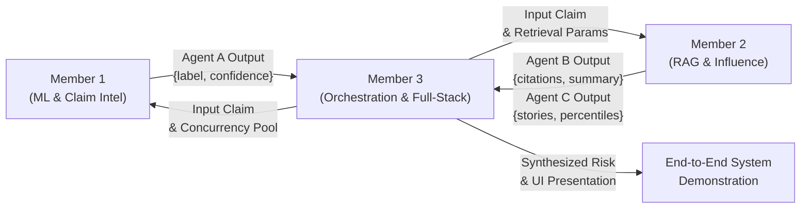

# Three-Member Engineering Work Division

**Project Title:** AI-Powered Agentic System for Political Misinformation Detection, Influence Analysis and Propagation Mitigation  
**Project Category:** Final Year College Major Project (3 Students)  
**Allocation Strategy:** Technically Balanced, Highly Defensible, Equal Cognitive & Effort Distribution  

---

## 1. Executive Work Allocation Overview

To ensure that all three team members have deep, defensible technical ownership for project presentations, viva examinations, and code reviews, the engineering tasks are partitioned into three dedicated domains:

```
┌───────────────────────────────────────────────────────────────────────────┐
│                      CORE SYSTEM ARCHITECTURE                            │
├─────────────────────┬─────────────────────┬───────────────────────────────┤
│      MEMBER 1       │      MEMBER 2       │           MEMBER 3            │
│   ML & Claim Intel  │ RAG & Historical DB │   Orchestrator & Full-Stack   │
├─────────────────────┼─────────────────────┼───────────────────────────────┤
│ • DistilBERT 6-class│ • Persistent Chroma │ • Orchestration Workflow      │
│ • TF-IDF Baseline   │ • ONNX Embeddings   │ • Concurrent ThreadPool (N=3) │
│ • Softmax Calib.    │ • Hybrid Score (α)  │ • Agent D Synthesis & Risk    │
│ • Label Topology    │ • TSV Alignment Heur│ • Agent E Advisory Mitigation │
│ • Evaluation Scripts│ • Snowflake Decoding│ • FastAPI Endpoints           │
│ • Error Analysis    │ • Tweet Percentiles │ • React 19 UI & Visual State  │
└─────────────────────┴─────────────────────┴───────────────────────────────┘
```

---

## 2. Comparative Responsibility Matrix

| Dimension | Member 1 (ML & Claim Intelligence) | Member 2 (RAG & Historical Intelligence) | Member 3 (Orchestration & Full-Stack) |
| :--- | :--- | :--- | :--- |
| **Primary Domain** | Deep Learning Transformers, Natural Language Processing, Statistical Classification | Vector Databases, Hybrid Information Retrieval, Temporal Propagation Mathematics | Multi-Agent Systems, Concurrency, Risk Modeling, Full-Stack Web Architecture |
| **Core Components** | DistilBERT Sequence Classifier, TF-IDF Baseline, Softmax Calibration | Persistent ChromaDB Vector Index, ONNX Runtime, FakeNewsNet Benchmark | OrchestrationWorkflow, VerificationRiskAgent, MitigationRecommendationAgent, React UI |
| **Primary Files** | `backend/main.py:108-188, 303-499`<br>`backend/agents.py:30-100`<br>`notebooks/03_baseline_model.ipynb`<br>`notebooks/04_distilbert_training.ipynb` | `backend/rag_engine.py`<br>`backend/evidence_retriever.py`<br>`backend/influence_analyzer.py`<br>`scripts/data_preprocessing/` | `backend/orchestrator.py`<br>`backend/agents.py:251-514`<br>`backend/main.py:606-644`<br>`frontend/src/App.jsx`<br>`frontend/src/App.css` |
| **Mathematical / Algorithmic Core** | Softmax activation $\sigma(\mathbf{z})_i$, Cross-entropy loss $\mathcal{L}_{CE}$, Macro F1, WordPiece tokenization | Cosine similarity/distance, Hybrid score fusion $\alpha \cdot S_{\text{sem}} + (1-\alpha) \cdot S_{\text{lex}}$, Snowflake bit-shift $(\text{id} \gg 22) + t_{\text{epoch}}$, Empirical percentile | ThreadPool synchronization, Error isolation boundary, Risk & uncertainty matrix, React render lifecycle |
| **Primary Technologies** | PyTorch, Hugging Face Transformers, Scikit-learn, Safetensors | ChromaDB, ONNX Runtime, Scikit-learn, JSONL streaming, Datetime bit arithmetic | FastAPI, Pydantic v2, ThreadPoolExecutor, React 19, Vite, Modern CSS3 |
| **Estimated Person-Hours** | **42 Hours** | **44 Hours** | **44 Hours** |
| **Key Viva Defense Topic** | Transformer self-attention, DistilBERT vs BERT parameter reduction, 6-class imbalance handling, why confidence $\neq$ truth | Dense vector search vs lexical search, HNSW indexing, Snowflake ID bit layout, empirical percentile mathematics | Multi-agent coordination vs monolithic pipelines, concurrency safety, contradiction resolution, ethical mitigation |

---

## 3. Detailed Member Breakdown

### 3.1 Member 1: Machine Learning & Claim Intelligence

#### A. Core Responsibilities
1. **DistilBERT Sequence Classifier:** Maintain, profile, and explain the fine-tuned DistilBERT model (`models/distilbert_liar_final/model.safetensors`, 66M parameters).
2. **Baseline Model:** Maintain the TF-IDF + Logistic Regression baseline (`models/baseline_model.pkl` and `tfidf_vectorizer.pkl`) to guarantee defensible comparative benchmarking.
3. **Softmax Confidence Calibration:** Implement and defend the mathematical distinction between statistical probability distribution over LIAR classes and verified factual truth.
4. **Agent A (`ClaimAnalysisAgent`):** Own the execution, latency optimization, and semantic risk mapping of Agent A within the multi-agent system.
5. **Offline Evaluation & Validation:** Develop dedicated test-split evaluation scripts to report Accuracy, Macro F1, Per-class Precision/Recall, and Confusion Matrices across both models.
6. **Model Robustness & Failure Analysis:** Analyze edge cases such as adversarial negations, out-of-vocabulary terms, and input length truncation (128 WordPiece tokens).

#### B. Primary Source Files
- `backend/main.py` (Lines 87–188, 303–499)
- `backend/agents.py` (Lines 19–101: `ClaimAnalysisAgent`)
- `notebooks/03_baseline_model.ipynb`
- `notebooks/04_distilbert_training.ipynb`
- `tests/test_rag_and_agents.py` (Agent A test suite)

#### C. Concrete Deliverables
- [ ] Comprehensive ML evaluation CLI script (`scripts/evaluate_models.py`) calculating test set Macro F1 and confusion matrices.
- [ ] Formal mathematical report on DistilBERT distillation loss and attention mechanisms.
- [ ] Adversarial test suite with 20 challenging political claims (e.g., double negatives, sarcastic claims).
- [ ] Viva defense slides on Transformer architecture and classification calibration.

---

### 3.2 Member 2: Hybrid RAG & Historical Intelligence

#### A. Core Responsibilities
1. **Persistent ChromaDB Vector Store:** Maintain and optimize the persistent ChromaDB collection (`dataset/politifact_evidence/chroma_db/`) holding historical LIAR-PLUS evidence.
2. **Dense ONNX Embedding Pipeline:** Profile local vectorization using `all-MiniLM-L6-v2` via ONNX runtime, ensuring sub-50ms query embedding without external API dependency.
3. **Lexical Retrieval Engine:** Maintain `backend/evidence_retriever.py`, managing sublinear TF scaling, split isolation (`train` split only), and candidate indexing.
4. **Hybrid Score Fusion:** Calibrate and defend the weighted fusion formula $\text{Score}_{\text{hybrid}} = \alpha \cdot \text{Score}_{\text{sem}} + (1 - \alpha) \cdot \text{Score}_{\text{lex}}$.
5. **LIAR-PLUS Upstream TSV Heuristics:** Maintain `check_claim_justification_alignment()` to detect and flag historical scraping row-shift anomalies.
6. **Agent B (`EvidenceRAGAgent`):** Manage citation formatting, evidence consensus/conflict detection, and deterministic summary generation.
7. **Agent C & Influence Analyzer:** Maintain `backend/influence_analyzer.py`, 64-bit Twitter Snowflake bit-shift decoding, 24-hour volume calculation, and empirical percentile ranking across 1,056 FakeNewsNet stories.

#### B. Primary Source Files
- `backend/rag_engine.py` (Full file)
- `backend/evidence_retriever.py` (Full file)
- `backend/influence_analyzer.py` (Full file)
- `backend/agents.py` (Lines 102–250: `EvidenceRAGAgent` & `HistoricalInfluenceAgent`)
- `tests/test_evidence_retrieval.py`
- `tests/test_influence_analysis.py`

#### C. Concrete Deliverables
- [ ] Background indexing script to complete ingestion of remaining LIAR-PLUS training records into ChromaDB.
- [ ] Empirical benchmarking experiment comparing Pure Dense vs Pure Lexical vs Hybrid ($\alpha=0.5$) retrieval recall.
- [ ] Snowflake ID validation suite testing edge cases (boundary year 2026, legacy IDs, negative numbers).
- [ ] Viva defense slides on Vector Search (HNSW, Cosine Distance) and Snowflake bit-shift mathematics.

---

### 3.3 Member 3: Orchestration, Risk Modeling & Full-Stack Integration

#### A. Core Responsibilities
1. **Multi-Agent Orchestrator:** Maintain `backend/orchestrator.py` (`OrchestrationWorkflow`), managing the two-phase execution lifecycle (Phase 1 parallel thread pool, Phase 2 & 3 sequential).
2. **Concurrency & Thread Safety:** Manage `ThreadPoolExecutor(max_workers=3)` and async event loop bridging via `loop.run_in_executor()`.
3. **Fault Isolation (`_safe_resolve`):** Guarantee that unhandled crashes in individual agents are safely caught and transformed into structured error traces without crashing FastAPI.
4. **Agent D (`VerificationRiskAgent`):** Own the cross-agent synthesis matrix, contradiction detection logic between DistilBERT predictions and PolitiFact rulings, and continuous uncertainty scoring ($0.0 - 1.0$).
5. **Agent E (`MitigationRecommendationAgent`):** Own the rule-based mitigation engine, prioritizing non-coercive advisory actions and enforcing non-execution disclaimers.
6. **FastAPI Endpoints & Contracts:** Maintain backend routes (`/agent/analyze`, `/compare`, `/predict`), Pydantic validation, and CORS policies.
7. **React 19 Frontend Interface:** Maintain `frontend/src/App.jsx` and `App.css`, managing all 10 UI components, agent trace accordion, risk badge styling, responsive layouts, and user session history.

#### B. Primary Source Files
- `backend/orchestrator.py` (Full file)
- `backend/agents.py` (Lines 251–514: `VerificationRiskAgent` & `MitigationRecommendationAgent`)
- `backend/main.py` (Lines 1–107, 189–302, 501–657)
- `frontend/src/App.jsx` (Full file)
- `frontend/src/App.css` (Full file)
- `tests/test_rag_and_agents.py` (Orchestration & Agent D/E tests)
- `tests/test_frontend_backend_integration.py`

#### C. Concrete Deliverables
- [ ] End-to-end integration tests verifying graceful degradation when backend sub-services simulate timeouts.
- [ ] Frontend UI polish: accessible color contrast verification for WCAG AA compliance and mobile view testing.
- [ ] Trace latency profiling report measuring wall-clock duration of parallel Phase 1 vs sequential Phase 2.
- [ ] Viva defense slides on Multi-Agent Orchestration, Fault Isolation, and Risk Synthesis.

---

## 4. Shared Integration Touchpoints & Dependency Graph



### 4.1 Interface Contracts
1. **Contract 1 (Member 1 $\to$ Member 3):**
   Agent A must return a dictionary conforming to:
   ```json
   {
     "agent_id": "claim_analysis_agent",
     "status": "completed",
     "duration_ms": 45.2,
     "summary": "DistilBERT classified claim as 'false' with 88.4% confidence.",
     "data": { "label": "false", "confidence": 0.884, "risk_category": "HIGH" }
   }
   ```
2. **Contract 2 (Member 2 $\to$ Member 3):**
   Agent B and Agent C must return dictionaries conforming to standard trace payloads with citations, evidence status, matched stories, and Twitter Snowflake propagation metrics.
3. **Contract 3 (Member 3 $\to$ Frontend):**
   The combined JSON response from `POST /agent/analyze` must include `execution_trace`, `claim_analysis`, `evidence_rag`, `historical_influence`, `verification_risk`, and `mitigation_recommendations`.

---

## 5. Engineering Effort & Timeline Allocation

| Phase | Duration | Member 1 Tasks | Member 2 Tasks | Member 3 Tasks |
| :--- | :--- | :--- | :--- | :--- |
| **Phase 1: Deep Code Mastery & Audit** | Week 1 (10 hrs) | Profile DistilBERT weights, inspect tokenization, study `04_distilbert_training.ipynb`. | Inspect ChromaDB SQLite store, test Snowflake decoding formulas, audit JSONL schemas. | Audit `OrchestrationWorkflow`, trace state transitions, inspect React component tree. |
| **Phase 2: Individual Enhancements** | Week 2 (15 hrs) | Write `scripts/evaluate_models.py`, generate test confusion matrices, run adversarial inputs. | Run ChromaDB batch-indexing script, benchmark hybrid $\alpha$ parameter variations. | Profile thread pool concurrency, test agent failure isolation, refine React UI styles. |
| **Phase 3: Integration & Cross-Testing** | Week 3 (10 hrs) | Validate Agent A responses under high-throughput concurrent loads. | Verify RAG response latencies under hybrid search candidate pool expansion. | Run full 57-test pytest suite, verify Vite build, run end-to-end browser walkthroughs. |
| **Phase 4: Viva Prep & Project Defense** | Week 4 (8 hrs) | Rehearse Transformer Q&A, calibration formulas, and benchmark metrics defense. | Rehearse Vector Search, Cosine math, Snowflake bit-shift arithmetic defense. | Rehearse Multi-Agent Concurrency, Risk Synthesis, and Ethical Disclaimers defense. |
| **Total Allocation** | **43 Hours** | **42 Hours** | **44 Hours** | **44 Hours** |

---

## 6. Project Defense Ownership Summary

When defending the major project before external examiners:
- **Member 1** leads the defense on **Detection & Classification**: explains why DistilBERT was selected, how WordPiece tokenization works, how the 6-class LIAR dataset was preprocessed, and how statistical confidence is calibrated.
- **Member 2** leads the defense on **Evidence Retrieval & Propagation Indicators**: explains how ChromaDB performs dense vector retrieval, why hybrid search beats pure keyword search, how Twitter Snowflake IDs encode timestamps, and how empirical percentiles are computed.
- **Member 3** leads the defense on **System Orchestration & Mitigation**: explains why an agentic architecture was used instead of a monolith, how `ThreadPoolExecutor` enables parallel execution, how Agent D detects contradictions between model predictions and historical evidence, and why mitigation recommendations are strictly advisory.

